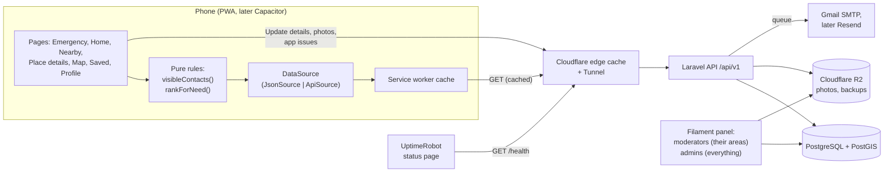
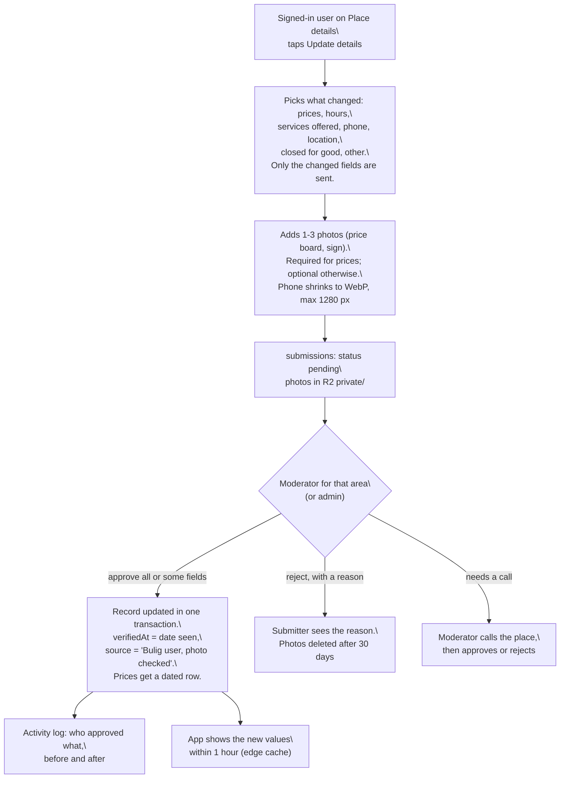

# Bulig Architecture

How each phase of the [Roadmap](ROADMAP.md) is built, how it connects to the phases before it, and what it should deliver.

Last updated: 2026-10-30 · Owner: John · Status: draft for review

## How to use this file

The Roadmap says **when** to build each part. This file says **how** to build it and **what it plugs into**. Read the "Four spines" section once. Every phase after that is a small addition to one of those spines.

Design rule: **no new moving parts unless a phase can't ship without them.** Each connection here is a plain function, one interface, one table, or one endpoint. No microservices, no Redis, no realtime, no state library.

## Stack (₱0 until funded)

Everything below has a free plan that covers the pilot, and none needs a card except where marked. Decided with John on 2026-10-30; the reasoning and sources are in the [₱0 stack doc](https://claude.ai/artifact/Xj4RDhtc5hR2QaroQKQ45U).

| Layer | Tool | Phase | Free limit | Note |
| --- | --- | --- | --- | --- |
| App | React 19 + TypeScript 6 + Vite 8 PWA | 1+ | free | Decided; not reopened |
| App hosting | Cloudflare Worker, static assets (`app.bulig.workers.dev`) | 1+ | 100k requests/day | |
| Map, address, routes | MapLibre + OpenFreeMap, Nominatim, OSRM | 3+ | free, no SLA | |
| Offline | Service worker (vite-plugin-pwa) | 2+ | free | Emergency never depends on the API |
| Analytics | Cloudflare Web Analytics | 3+ | free, no cookies | |
| API | Laravel 13, PHP 8.5 | 4+ | free | |
| Sign-in | Laravel Sanctum tokens | 4+ | free | Not Clerk: Clerk's production mode needs a domain you own |
| Roles and permissions | `spatie/laravel-permission` + Filament Shield | 4+ | free | New roles are rows, not code ([Spine 4](#4-identity)) |
| Admin and moderator panel | Filament 5 | 4+ | free | |
| Audit trail | `spatie/laravel-activitylog` | 4+ | free | Who changed what, before and after |
| Live dashboard | Laravel Pulse | 4+ | free | Active users, slow requests, errors, queue |
| Database | PostgreSQL 17 + PostGIS on the server; Neon (Singapore) only if hosting falls back to Render | 4+ | Neon: 1 GB, 100 CU-hours/month | Neon sleeps after 5 min; anything that polls it burns the hours |
| Server | Oracle Always Free Ampere VM, Singapore (card needed at signup); fallback Render free, Singapore | 4+ | Oracle 4 cores, 24 GB; Render 512 MB, sleeps after 15 min | |
| HTTPS without a domain | Cloudflare Tunnel | 4+ | free | |
| Photos (places, update proofs) | Cloudflare R2 (checkout may ask for a card) | 4+ | 10 GB, free downloads | One bucket, two prefixes: `public/` and `private/` |
| Email | Gmail SMTP with an app password; Resend once `bulig.app` is bought | 4+ | Gmail ~500/day; Resend 100/day, 3,000/month | Resend without a domain only emails your own inbox |
| Cache | Cloudflare edge cache on public reads + Laravel `file` cache | 4+ | free | No Redis |
| Rate limits | Laravel `RateLimiter` (`throttle`) + one Cloudflare rule on `/api/v1/auth/*` | 4+ | free | Limits in [API.md §1](API.md#1-conventions) |
| Queue and scheduler | Laravel `database` queue, `schedule:run` from cron | 4+ | free | On Render: GitHub Actions schedule instead of cron |
| Uptime and status page | UptimeRobot (pings `GET /health`, public status page) | 4+ | 50 monitors, 5-min checks | |
| Errors | Sentry free plan | 4+ | free plan | |
| Backups | Nightly `pg_dump` to R2 `private/backups/` | 4+ | inside R2's 10 GB | Keep 14 days |
| Tests and CI | Vitest, Pest 5, GitHub Actions | 1+ | 2,000 min/month (private repo) | |
| Domain (first paid item) | `bulig.app` at Cloudflare Registrar | when funded | about USD 14/year | Unlocks Resend and `api.bulig.app` |

**Redis comes in only** when the database cache or queue measurably slows the API, or there is more than one API server.

---

## System map (end of Phase 5)



Before Phase 4, the right side is just static JSON files served by the Cloudflare Worker (static assets). The left side doesn't change.

---

## The four spines

### 1. Data contract

The shape of a record is decided once, in Phase 2, and never broken.

- `app/src/types.ts` holds the TypeScript types.
- `contracts/emergency-contacts.schema.json` and `contracts/services.schema.json` hold the same shape as JSON Schema.
- Every data file and every API response uses the same envelope:

```json
{ "version": 1, "updatedAt": "2026-11-15T00:00:00Z", "items": [ ... ] }
```

```ts
// app/src/types.ts
export type CountryCode = string; // ISO 3166-1 alpha-2, upper case: "PH", "US", "DE"
export type AreaId = string;      // slug, unique worldwide: "ph-eastern-samar-guiuan"

export interface Area {
  id: AreaId;
  country: CountryCode;
  name: string;              // "Guiuan"
  region: string;            // province or region: "Eastern Samar"
  level?: string;            // the country's word for it: "city", "municipality", "barangay"
  parent?: AreaId | null;    // the area it sits inside (a barangay's city); null = top level
  languages: string[];       // BCP 47, first is the default UI language: ["en", "war"]
}

export type Category = 'tire_repair' | 'mechanic' | 'fuel' | 'hospital' | 'food' | 'lodging' | 'store';

export interface EmergencyContact {
  id: string;                // stable slug, e.g. "ph-eastern-samar-guiuan-mdrrmo"
  country: CountryCode;
  area: AreaId | null;       // null = nationwide line, e.g. 911 in PH, 112 in DE
  name: string;              // "Guiuan MDRRMO"
  kind: 'national' | 'police' | 'fire' | 'medical' | 'rescue' | 'coast_guard' | 'disaster';
  phones: string[];          // E.164 or local format as dialled, first is primary
  verifiedAt: string;        // ISO date of the last check
  source: string;            // who or what confirmed it
  sample?: boolean;          // true only in Phase 2 sample data
}

export interface Service {
  id: string;
  country: CountryCode;
  area: AreaId;
  category: Category;        // global key; the label shown comes from labels.json
  name: string;
  phone?: string;            // E.164 preferred, so tel: links work from abroad
  landmark: string;          // "Beside Guiuan public market"
  lat?: number;
  lng?: number;
  hours?: string;            // free text until weekly hours are validated
  subtype?: string;          // the owner's word, shown instead of the category: "Halo-halo"
  addedAt?: string;          // ISO date first listed; NEW badge for 60 days
  verifiedAt: string;
  source: string;
  sample?: boolean;
}

export interface Envelope<T> { version: 1; updatedAt: string; items: T[] }
```

**Going global without rewriting later**

- Every record carries `country` and `area` from the first sample file. Bulig starts in one area, but nothing in the code assumes which one.
- Data lives in one folder per country: `public/data/<cc>/areas.json`, `emergency-contacts.json`, `services.json` and `labels.json` (lower-case `cc`, e.g. `ph`). The phone only downloads the country the user picked, so the download stays small as countries are added.
- `labels.json` maps each `Category` to local words per language, e.g. `tire_repair` → `{ "en": "Vulcanizing", "war": "Vulcanizing" }` in `ph/`, `{ "en": "Tire repair" }` in `us/`. Category keys never change; only labels do.
- The national emergency number is **data**, not code: a `kind: 'national'` contact with `area: null`. The code never contains "911".
- UI text goes through one small `t(key)` lookup with English as the fallback (no i18n library until there are 3+ languages).

**Rules**

- Adding an optional field is allowed. Renaming, removing or changing the type of a field means `version: 2`, and the app must support both versions until every cached copy is gone (about 30 days).
- Vitest validates the JSON files against the schema. In Phase 4, Pest validates the API responses against the **same** schema files. If either side drifts, CI goes red.
- Dev dependencies this needs: `ajv` (frontend) and `opis/json-schema` (backend). Nothing else.

### 2. Data source adapter

Pages never fetch data themselves. They call one hook, which calls one interface. Every request on the wire, with payloads and errors, is in [API.md](API.md).

```ts
// app/src/data/DataSource.ts
export interface DataSource {
  areas(country: CountryCode): Promise<Envelope<Area>>;
  emergencyContacts(country: CountryCode): Promise<Envelope<EmergencyContact>>;
  services(country: CountryCode): Promise<Envelope<Service>>;
}
```

- Phase 2: `JsonSource` fetches `/data/<cc>/areas.json`, `/data/<cc>/emergency-contacts.json` and `/data/<cc>/services.json`.
- Phase 4: `ApiSource` fetches `GET /api/v1/areas?country=`, `GET /api/v1/emergency-contacts?country=` and `GET /api/v1/services?country=`.
- `LIVE_COUNTRIES` in `app/src/data/countries.ts` lists the countries that are live (a country picker appears once there are two). The first visit guesses the country from the browser language and lets the user change it; the choice is saved in `localStorage`. No location permission is needed.
- `VITE_DATA_SOURCE=json|api` picks one at build time. If the API breaks, flip it back to `json` and redeploy. That takes about 2 minutes.
- Phase 2 and 3: the service worker (vite-plugin-pwa) **precaches** the JSON files with the app shell, so offline works from the first visit and each deploy ships fresh data. Phase 4: the API responses use `NetworkFirst` with a 3 second timeout. Offline behaviour is the same in every phase.

**The emergency rules always run on the phone**, in `visibleContacts(contacts, now)`. Cached data gets older while the phone is offline, so only the phone knows how stale it really is. The server also refuses to serve unverified contacts, but the phone is the last line of defence.

### 3. Community updates pipeline

Every change that doesn't come from a moderator or admin goes through **one form, one endpoint and one review queue**. A driver who fuelled this morning and saw a new price, a shop with a new air pump, a closed hospital ward, a new carinderia: all of them are an **Update details** on a place, posted to `POST /api/v1/submissions` ([API.md §7](API.md#7-community-updates-update-details)). Business owners use the same form from Phase 5.



| Phase | What comes in | Who reviews | What goes public |
| --- | --- | --- | --- |
| 3 | Nothing (sample data; John fixes the JSON by hand) | | |
| 4 | Update details from users: prices, hours, services, phone, location, closed, new place, with photos | Moderator for the area, or an admin | Only the fields a reviewer approves |
| 5 | Same form, plus hazard reports and owner edits | Same queue | Same approval step |

**Rules in every phase**

- Nothing a member of the public submits is shown until a moderator or admin approves it. There is no auto-approve, even for frequent reporters (revisit only when the queue takes over 2 hours a week).
- **Emergency contacts can't be edited through this pipeline.** A user can flag one ("number not working"); only an admin changes it, after calling it.
- **Prices are never "current".** Each price is stored with the date it was seen and shown as "₱82.00 · seen 30 Oct by a Bulig user". The app greys a price out after 7 days and hides it after 30, because fuel prices in the Philippines change most weeks.
- Each submission shows the reviewer the current value next to the proposed one, field by field, with the photos. Approving applies only the ticked fields.
- Photos have their location and camera data stripped on the server before anyone sees them. A reviewer can blur or reject a photo that shows faces or plate numbers. Only approved photos ever move to `public/`.
- Abuse: 10 submissions a day per user. A user whose last 10 submissions were mostly rejected is flagged in the panel, and an admin can suspend them. Rejected submissions count; approved ones don't earn anything (no points or rewards yet).

### 4. Identity

Roles, scopes and the sign-in phases are in [WORKFLOW.md](WORKFLOW.md#roles). In short: **user**, **moderator** (scoped to an area and the areas inside it) and **admin**, decided by one function, `can()` in `app/src/rules/permissions.ts`.

- **Now (test UI):** everything except Emergency needs an account (John, 2026-10-30). Three test logins (`test@`, `moderator@`, `admin@bulig.com`) plus accounts made on the phone (`auth/localAccounts.ts`, salted SHA-256 hash). Guests ("Continue without an account") get Emergency only. Not security: it goes when Phase 4 sign-in lands.
- **Phase 4:** real accounts on the API with Sanctum tokens: register, login, logout, forgot and reset password, `/me` (profile, photo, password, delete) and `/me/saved`. Every request and payload is in [API.md](API.md). Admins and moderators also sign in to Filament.
- **Phase 5:** Google sign-in (Socialite), business owners claiming listings, in-app reports (`POST /submissions`).
- Emergency Help never needs an account, in any phase.

**Roles from Phase 4.** Roles live on the server as data (`spatie/laravel-permission`), so adding one later (owner, LGU partner, regional lead) is a new row with a set of permissions, not new code. The app's `can()` keeps working from the `role` the API returns.

| Role | Can do | Scope |
| --- | --- | --- |
| **User** | Save places; send Update details with photos; report an app problem; see the status of their own submissions | Everywhere |
| **Moderator** | Everything a user can, plus: review and approve or reject submissions, add and edit places and their photos, mark records checked, see and work on app problems | Their areas and the areas inside them. Until there are more moderators, John is admin and covers the whole country |
| **Admin** | Everything: users and moderators (add, edit, suspend, change role, assign areas), every place and photo, emergency contacts, areas, system settings, the live dashboard and the activity log | Everywhere |

A moderator's own edits go live straight away but are written to the activity log with before and after values, so an admin can see and revert them. Emergency contacts are admin-only.

---

## Phase 1: Skeleton (v0.1)

**Features and how they're built**

| Feature | How |
| --- | --- |
| Repo layout | `app/` (React + Vite), `contracts/` (Phase 2), `api/` (Phase 4), `docs/`. One repo, no monorepo tooling. |
| CI | `.github/workflows/ci.yml`: `npm ci`, `npm run lint`, `npx vitest run`, `npm run build`, run with `working-directory: app`. Branch protection on `main` requires it. |
| Deploy | Cloudflare Worker with static assets: root `app`, build `npm run build`, deploy `npx wrangler deploy`. `app/wrangler.jsonc` serves `dist` and has an empty `previews` block so every PR branch gets a preview URL. |
| App shell | React Router 8 declarative routes `/`, `/services` and `/about` inside a `<Layout>` with a bottom tab bar. `wrangler.jsonc` sets `not_found_handling: "single-page-application"` so refreshing any route works. |

**Connects to:** nothing before it. Every later phase ships through this pipeline (pull request, CI, `main`, live), and the three routes never break, so links shared on Facebook keep working. (Phase 3 adds new routes; `/services` and `/about` stay.)

**Contract changes:** none.

**Expected outcome:** a merge to `main` is live on `*.workers.dev` in about 2 minutes, a pull request with a type error can't merge, and you know your real weekly pace.

---

## Phase 2: Emergency and Services, offline (v0.2)

**Features and how they're built**

| Feature | How |
| --- | --- |
| Data contract | `types.ts`, `validateEnvelope()` (JSON Schema files wait for Phase 4), and sample JSON with 3 to 5 records each, all marked `"sample": true`. A Vitest test validates every file against its schema. |
| Data access | `JsonSource` behind `<DataProvider>`, which loads one country once for the whole app. Pages call `useAppData()` → `{ country, data: { status: 'loading' | 'ready' | 'error', ... }, area, setArea, online, retry }`. |\| 'ready' \| 'error', emergency, services }`. |
| Emergency rules | `visibleContacts(contacts, now)` in `app/src/rules/emergency.ts`: the country's `kind: 'national'` number(s) always first and never hidden, then the picked area's numbers sorted by kind, and anything with `verifiedAt` older than 180 days removed. Unit-tested, including the 180-day boundary and a missing date. |
| Emergency page | Calls `visibleContacts()`. Each number is a `tel:` link with a "Last checked" date. The copy never says help was sent or a location was shared. |
| Service rules | `filterServices(services, { area, category, query })` in `app/src/rules/services.ts`. Unit-tested. |
| Services page | Area picker (country, then area, saved in `localStorage`), category chips, search, then call and directions buttons. Directions open `https://www.google.com/maps/dir/?api=1&destination=lat,lng`, so there's no maps SDK. |
| Offline | vite-plugin-pwa: precache the app shell **and** `data/**/*.json`, plus a web manifest and icons so it can be installed. "Offline, showing saved data" note from `navigator.onLine`. |

**Connects to:** Phase 1's routes and pipeline. This phase creates spines 1 and 2, which everything later depends on. Pages only call `useAppData()`, `visibleContacts()` and `filterServices()`.

**Contract changes:** contract v1 is created.

**Expected outcome:** in airplane mode, after one visit, both tabs work fully. The emergency rules are covered by tests. Swapping the data source later won't touch any page.

---

## Phase 3: First pilot in the Philippines (v0.3)

**Features and how they're built**

| Feature | How |
| --- | --- |
| Real data | Replace the sample files with verified records from SCRUM-17 and SCRUM-18. A CI test fails if any record still has `"sample": true`. |
| Report wrong info | Moved to Phase 4 as **Update details**: in the app, `POST /submissions` (no Google Form). |
| Analytics | Cloudflare Web Analytics script tag. No cookies, no consent banner needed. |
| Navigation | **Built.** Five tabs: `/` Home, `/services`, `/map`, `/saved`, `/profile` (the tab shows the photo, or Ropi). Emergency (`/emergency`) is not a tab: a floating red button opens it from every screen and Back returns. No top bar. Pushed screens: `/nearby/:need`, `/profile/edit`, `/profile/password`, `/help`, `/terms`, `/privacy`, `/licenses`, `/about`. `/services/:category` renders Nearby results, so v0.2 links still work. Screens in [UI-UX.md](UI-UX.md). |
| Needs | **Built.** `app/src/rules/needs.ts` maps each need (`flat-tire`, `breakdown`, `out-of-gas`, `hospital`, `food`, `hotel`, `store`, `others`) to a category, its words and whether it is urgent. Data, not page code, so a new need is one entry. Filter chips per need wait for `Service.features` data. |
| Location | **Built.** `LocationProvider` (`app/src/location/`) follows the phone with `navigator.geolocation.watchPosition` from when the app opens; `refresh()` asks for one fresh fix. `nearestArea()` picks the area. The address (barangay, municipality, province, ZIP) comes from Nominatim, rounded to ~110 m, after a 250 m move or a refresh, cached in `bulig.address`. `LocationLine` shows it on Home (between the bento and the hotline) and on Emergency, or an area picker without GPS. |
| Ranking | **Built.** `byDistance()` in `rules/nearby.ts` (haversine; no coordinates last; by name without a position), then `rankForNeed()` in `rules/needs.ts`: the need's category, the chosen chips (confirmed features, or usually open now), hospitals with `emergency_room` first, and `nearestOpen` when the nearest is usually closed. Hours rules in `rules/hours.ts` (phone-local time; `Area.timeZone` if a country spans zones). |
| Home | **Built.** `ServiceBento` is the "What's wrong?" grid (one tile per need, the first large, Others wide), then `LocationLine`, the national hotline from `visibleContacts()`, local numbers, nearest places and Saved. No mini map. |
| Map | **Built.** `MapPage` imports `maplibre-gl` dynamically (its own ~270 kB gzipped chunk, kept out of the offline cache). OpenFreeMap `positron` style recoloured by `applyMapTheme()` (`app/src/map/mapTheme.ts`) for light and dark. Pins are React portals into MapLibre markers. `?cat=` filters, `?to=<id>` opens a route. Routes: `fetchRoute()` (`app/src/map/route.ts`) calls OSRM on `routing.openstreetmap.de` (car or foot, GeoJSON), refetched when the phone enters a new ~200 m cell, drawn as a line layer. Offline or no WebGL: a list. |
| Saved and accounts | **Built.** `AuthProvider` (`app/src/auth/`): test logins in `testAccount.ts`, accounts made on the phone in `localAccounts.ts` (salted SHA-256 hash, `bulig.accounts`), session `bulig.session`, guest mode `bulig.guest`, saved IDs `bulig.saved.<email>`, profile details and photo `bulig.profile.<email>`. `RequireAccount` guards every route but Emergency, Help and the legal pages. See [WORKFLOW.md](WORKFLOW.md#sign-in). |
| Profile, legal and install | **Built.** Profile is a settings screen (`components/Settings.tsx`): edit profile with a photo (`auth/photo.ts`, 256px WebP), change password, theme (`theme.ts`, applied before first paint from `index.html`), install (`install.ts`: `beforeinstallprompt` on Android, steps on iPhone), Help, Terms and Privacy (drafts), licences, delete account, and "v<version> · build <commit>" (injected by `vite.config.ts`). Local-language About is still to do. |
| Share preview | Open Graph tags and a 1200x630 image in `index.html`. |

**Connects to:** spine 1 (real data, same contract plus optional fields), spine 2 (the map, Home and Nearby results are views of the same data, not a second data path), and spine 3 (the report button starts the feedback pipeline).

**Contract changes:** a new category, `lodging` (hotels and inns), and optional fields only, so `version` stays 1: `Area.lat`, `Area.lng`, `Service.features`, `Service.weeklyHours`, `Service.open24h`, `Service.subtype`. See [UI-UX.md section 9](UI-UX.md#9-data-the-ui-needs).

**Expected outcome:** 30+ real users, 3+ reports received and fixed, and usage numbers for SCRUM-15. You'll also know whether the trigger for Phase 4 (more than about 1 hour a week of manual editing, or owners asking to edit their own listings) has actually happened.

---

## Phase 4: Backend and admin (v0.4)

**Features and how they're built**

| Feature | How |
| --- | --- |
| Laravel app | `api/` with Laravel 13, PHP 8.5 and PostgreSQL + PostGIS (`postgis/postgis` in Docker locally). Sessions, cache and queue all use the database driver, so there's no Redis. |
| Schema | `countries(code, name)`, `areas(id, country, name, region, languages jsonb)`, `category_labels(category, country, lang, label)`, `services(... , location geography(Point,4326) null, verified_at, source, deleted_at)`, `emergency_contacts(... , phones jsonb, verified_at, source)`, `submissions(id, user_id, type, record_type, record_id, area_id, changes jsonb, note, photo_ids jsonb, status, reviewer_id, review_note, approved_fields jsonb, reviewed_at, created_at)`, `uploads(id, user_id, r2_key, width, height, bytes, status, created_at)`, `service_prices` and `issues` (below), plus the package tables for roles, activity log, Pulse and settings. IDs stay the same slugs as the JSON. |
| Import | `php artisan bulig:import-json` reads the Phase 3 JSON files. Running it twice changes nothing (upsert by ID). |
| API contract | Build every endpoint to [API.md](API.md): public reads (areas, emergency contacts, services, labels), auth (register, login, logout, forgot and reset password), `/me` (profile, photo, password, delete) and `/me/saved`. Generate `contracts/openapi.yaml` from it at the start of the phase and test the responses against it. |
| Read API | `GET /api/v1/emergency-contacts` and `GET /api/v1/services`, with a required `?country=` and an optional `?area=`. They return the contract v1 envelope through API Resource classes, with `Cache-Control: public, max-age=3600`. Emergency only returns contacts with `verified_at` in the last 180 days, except `national` lines, matching `visibleContacts()`. |
| Contract tests | Pest tests validate both responses against `contracts/*.schema.json`. The 180-day rule is tested on the server too. |
| Panel | Filament 5 at `/panel` with Filament Shield. Admins and moderators sign in with the same account they use in the app. Resources: places (with photos), emergency contacts (admin only), areas, users, submissions, app issues, settings. A "Needs re-check" filter shows records last verified more than 150 days ago; "Mark verified" sets `verified_at` and `source`. Moderators only see records and submissions in their areas (a global scope on `area`). |
| Review queue | The submissions resource lists pending items oldest first, per area. Opening one shows current vs proposed values field by field, the photos, the submitter's history (approved / rejected count) and the place on a small map. Actions: approve ticked fields, reject with a reason, "Called, still pending". Approving runs one database transaction that updates the place, writes a `service_prices` row for each price, and logs the change. |
| Prices | `service_prices(id, service_id, item, amount, currency, unit, seen_at, submission_id, approved_by)`. History is kept, never overwritten; the API returns the newest approved price per item. Items come from `labels.json` per country (`ron91`, `ron95`, `diesel`, `lpg_11kg`, and later service items like `tire_patch`). |
| Photos | Phone shrinks each photo to WebP, max 1280 px and about 300 KB, then posts it to `POST /uploads`. Laravel re-encodes it with Intervention Image (strips location and camera data) and stores it in R2 `private/`. Reviewers see it through a 10-minute signed URL. Approved place photos are copied to `public/` and served from R2's public URL. Pending and rejected photos are deleted after 30 days by a scheduled job. |
| Users and moderators | Admin pages list every user with role, areas, status (active, suspended), last seen (`personal_access_tokens.last_used_at`), submissions approved / rejected. Admins can edit details, reset a password (sends the reset email), suspend, change role and assign areas. "Online now" = last seen in the last 15 minutes. No live tracking beyond that. |
| Live dashboard | Laravel Pulse at `/panel/pulse` (admins only): requests per minute, slow requests and queries, exceptions, queue backlog, most active users. It samples instead of logging every request, so it stays small. |
| Activity log | `spatie/laravel-activitylog` on places, emergency contacts, users, roles and settings. Each entry stores who, when, and old and new values. Admins can filter it per record or per person. |
| Settings | One Filament settings page (`spatie/laravel-settings`), admin only: announcement banner text, maintenance message, submissions on or off, daily submission limit, photo size limit, price "stale after" days. The app reads the public ones from `GET /settings` (cached). |
| App issues | Users report app problems from Profile ("Something's not working"). `issues(id, user_id, kind, message, page, app_version, device, status, assignee_id, created_at)`, with status `open`, `in_progress`, `fixed`, `wont_fix`. Moderators and admins see and work them in the panel; a "Copy to GitHub" action opens a prefilled GitHub issue for code fixes. The reporter sees the status in Profile. |
| Status | `GET /health` checks the database and R2 and returns `200` or `503`. UptimeRobot pings it every 5 minutes, emails John, and hosts the free public status page linked from Profile → Help. |
| Frontend switch | Add `ApiSource` and build with `VITE_DATA_SOURCE=api`. Keep the JSON files as the fallback build. |
| Hosting | Oracle Always Free VM (Singapore), Nginx, PHP-FPM, PostgreSQL + PostGIS, one `queue:work` process and cron for `schedule:run`, Cloudflare Tunnel for HTTPS, CORS allowing only the app's origin, nightly `pg_dump` to R2. Fallback: Render free (Singapore) + Neon (Singapore), with GitHub Actions running the schedule. |

**Connects to:** spine 1 (the same schema files now test the server), spine 2 (`ApiSource` replaces `JsonSource` and no page changes), spine 3 (Update details lands in `submissions`, so every community change goes through one queue), and spine 4 (roles and areas decide what each panel user sees).

**Contract changes:** additive only: optional `Service.prices` and `Service.photos` (see the contract change log). Everything else that exists keeps its shape. If the API needs a change to the shape, that's a design bug to fix in the API, not in the app.

**Expected outcome:** a user's price update with a photo is approved by a moderator and shows in the app within 1 hour, with its "seen" date. You edit a shop in Filament and the app shows it within 1 hour. Airplane mode still works. A restored backup matches production. Manual JSON editing stops.

---

## Phase 5: Community features (v0.5)

**Features and how they're built** (in this order, and stop when demand stops)

| Feature | How |
| --- | --- |
| Update details | Built in Phase 4 (`POST /api/v1/submissions`, [API.md §7](API.md#7-community-updates-update-details)); here only the extras: guest reports without an account. Protected by Cloudflare Turnstile (free), a honeypot field, and Laravel rate limiting (5 per hour per IP). `<ReportButton>` already posts here from Phase 4. |
| Hazard reports | Submission `type: 'hazard'` with `{ kind: flood \| landslide \| road_closed, lat, lng, note }`. Approving it creates a row in `hazards(id, kind, location, country, area, expires_at, approved_at)`. Default expiry is 24 hours for floods and 72 hours for landslides and closures. `GET /api/v1/hazards?country=&area=` returns approved, unexpired rows only, as an additive contract (`hazards.schema.json`). Shown as a banner on Services and as pins on the Map. |
| Owner accounts | Google sign-in through Laravel Socialite, issuing a Sanctum **token** (not a cookie, because the `workers.dev` app and the API host are different domains). The owner sends `type: 'claim'`. You confirm it by calling the shop's listed number. Approved owners send `type: 'owner_edit'` for hours and phone, and those are still reviewed. |
| Privacy and abuse | Store a salted hash of the IP, never the IP itself, and delete it after 30 days. Delete resolved submissions after 180 days. Add a "Report this" link on hazards. Publish a privacy notice per country served: Data Privacy Act (RA 10173) for the Philippines first, GDPR before any EU area. Notices are per-country files, like `labels.json`. |

**Connects to:** spine 3 (it adds an endpoint to the `submissions` table Phase 4 built; it's still the same review queue), and spine 4 (identity for owners only).

**Contract changes:** additive. `hazards.schema.json` is new, and `Service` gains an optional `ownerVerified?: boolean`. Version stays 1.

**Expected outcome:** 10+ real reports reviewed within 48 hours each, 3+ owners have claimed their listing, and moderation takes you under 2 hours a week.

---

## Phase 6: Android app with Capacitor (v1.0, optional)

**Features and how they're built**

| Feature | How |
| --- | --- |
| Native wrapper | Capacitor 8 in `app/`, wrapping the same `dist` build. `ApiSource` uses an absolute API URL from `VITE_API_URL`. Add the Capacitor origin (`https://localhost`) to the API's CORS list. |
| Store assets | Icon, splash screen, screenshots, and the privacy policy URL (the Phase 3 page). |
| Distribution | A signed APK shared directly (free). Google Play only once funded. |

**Connects to:** everything, unchanged. It's the same code, the same `DataSource` and the same rules. Only the shell is different.

**Contract changes:** none.

**Expected outcome:** it installs on 3 test phones, the PWA and the APK show the same data, and there's no second codebase to maintain.

---

## Phase 7: Grow beyond the pilot (v1.x)

Build only what the pilot proved people want. If they're built, these are the designs.

| Feature | How | Connects to |
| --- | --- | --- |
| More areas and countries | Add rows to `areas` (and `countries` for a new country), following `docs/OPEN-AN-AREA.md`. A new country needs its `national` emergency number(s), category labels, a privacy notice and at least one language before it goes live. Each area needs its own verified emergency list before it's allowed to show. | Spine 1 (data only; no code or contract change). `?country=` and `?area=` already exist, so the app downloads only the country a user picks. |
| Roadside help on the server | The problem buttons and nearest-first lists already ship in Phase 3, ranked on the phone. Once an area has too many places to send them all, move ranking to the server: `GET /api/v1/services?near=lat,lng&category=` using PostGIS `ST_DWithin` and `ORDER BY` distance, with `rankNearby()` kept as the offline fallback. Bulig never dispatches anyone. It logs an anonymous `help_requests(category, country, area, created_at)` count, which becomes demand data you can show businesses. | Spine 2 (one new `DataSource` method) and `filterServices()`. Offline, it falls back to the cached area list. |
| Stops along a route | The user picks a destination. Laravel calls a free routing API (for example OpenRouteService, with the key kept server-side and the results cached), then finds services within 2 km of the route line (`ST_DWithin` on the line, ordered by `ST_LineLocatePoint`). Endpoint: `GET /api/v1/route-stops?from=&to=&categories=`. This needs a connection. Offline, the app says so and shows the area list. | Same `services` table and the same contract. Results reuse the Services list component. |
| Business model | `ownerVerified` badge (Phase 5), and a `featured` flag that's always labelled "Featured" and never shown on Emergency Help. Local government and tourism office partnerships (LGUs in the Philippines) pay for data upkeep, not for placement. | Additive contract fields. No new system. |
| iOS | The same Capacitor project, once the USD 99 per year is funded. | Phase 6. |

**Expected outcome:** each area you add stays as accurate as the pilot area. If re-checking records falls behind (for example, more than 10% of an area's records are older than 150 days), stop adding areas until it's fixed.

---

## Contract change log

| Phase | Change | Version |
| --- | --- | --- |
| 2 | `Area`, `EmergencyContact`, `Service`, `Category` and `Envelope` created, with `country` and `area` on every record | 1 |
| 3 | Category `lodging`; `Area.lat`, `Area.lng`, `Area.level`, `Area.parent`, `Service.features`, `Service.weeklyHours`, `Service.open24h`, `Service.subtype` (all optional) | 1 |
| 5 | `hazards.schema.json` added; `Service.ownerVerified` (optional) | 1 |
| 3 | `Service.features` (`Partial<Record<Feature, boolean>>`), `Service.weeklyHours` (`{ mon: [["07:00","18:00"]] }`, overnight ranges allowed, `"24:00"` = midnight) and `Service.open24h`, all optional and validated; sample data converted from the free-text `hours` (kept for display). Added 2026-10-30. | 1 |
| 3 | Category `other` ("Others": new stalls and local finds); `Service.addedAt` (optional, ISO date first listed, drives the NEW badge for 60 days). `Service.subtype` is now shown in the UI. Added 2026-10-30. | 1 |
| 4 | `Service.prices` (optional: `[{ item, amount, currency, unit, seenAt }]`, newest approved per item) and `Service.photos` (optional: approved public photo URLs). Planned 2026-10-30. | 1 |
| 7 | New areas and countries (data only); `Service.featured` (optional) | 1 |

## Decisions and why

- **Client-side filtering, one country at a time.** The phone only holds the picked country's files. The pilot is a few hundred records (under 100 KB). If one country grows past about 1 MB, split its files by region; the contract doesn't change. Filtering on the phone is what makes offline mode work, and it keeps the API to a few read endpoints.
- **Emergency rules run on both sides.** The server stops bad data from going out. The phone handles data that went stale while it was offline.
- **One `submissions` table.** One moderation queue to check, one place for rate limits, and one retention rule. "Report wrong info" and "Update details" are the same form: a report is an update that says what's wrong without a new value.
- **Every public change is reviewed by a person.** Crowd data is only as good as its worst submitter, and a wrong price or a "closed" flag on the only vulcanizing shop for 20 km hurts someone. The cost is a review queue; the pilot is small enough for that.
- **Prices are dated sightings, not live prices.** Bulig can't know today's price. It can say what a user saw and when.
- **Roles as data.** `spatie/laravel-permission` lets an admin add a role later without a deploy.
- **No Redis, no websockets.** "Online now" is a last-seen time; caching is Cloudflare plus files; the queue is a table. Each of these is one config line to swap if the pilot ever outgrows it.
- **Status page from UptimeRobot, not built in-house.** If the server is down, a status page on the same server is down too.
- **Tokens instead of cookies for owners.** Sanctum's cookie mode needs the app and the API on the same domain, and the `workers.dev` app with a tunnel host isn't. Once `bulig.app` and `api.bulig.app` are bought, cookie auth becomes an option.
- **No maps SDK for directions.** A Google Maps link is free, works everywhere, and needs no API key.
