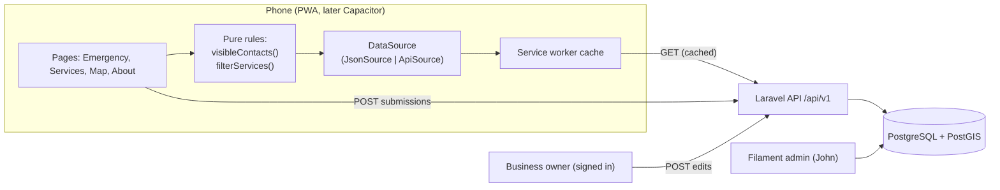

# Bulig Architecture

How each phase of the [Roadmap](ROADMAP.md) is built, how it connects to the phases before it, and what it should deliver.

Last updated: 2026-10-29 · Owner: John · Status: draft for review

## How to use this file

The Roadmap says **when** to build each part. This file says **how** to build it and **what it plugs into**. Read the "Four spines" section once. Every phase after that is a small addition to one of those spines.

Design rule: **no new moving parts unless a phase can't ship without them.** Each connection here is a plain function, one interface, one table, or one endpoint. No microservices, no Redis, no realtime, no state library.

---

## System map (end of Phase 5)



Before Phase 4, the right side is just static JSON files served by the Cloudflare Worker (static assets). The left side doesn't change.

---

## The four spines

### 1. Data contract

The shape of a record is decided once, in Phase 2, and never broken.

- `app/src/types.ts` holds the TypeScript types.
- `contracts/emergency-contacts.schema.json` and `contracts/services.schema.json` hold the same shape as JSON Schema.
- Every data file and every API response uses the same envelope:

```json
{ "version": 1, "updatedAt": "2026-11-15T00:00:00Z", "items": [ ... ] }
```

```ts
// app/src/types.ts
export type CountryCode = string; // ISO 3166-1 alpha-2, upper case: "PH", "US", "DE"
export type AreaId = string;      // slug, unique worldwide: "ph-eastern-samar-guiuan"

export interface Area {
  id: AreaId;
  country: CountryCode;
  name: string;              // "Guiuan"
  region: string;            // "Eastern Samar"
  languages: string[];       // BCP 47, first is the default UI language: ["en", "war"]
}

export type Category = 'tire_repair' | 'mechanic' | 'hospital' | 'fuel' | 'food' | 'store';

export interface EmergencyContact {
  id: string;                // stable slug, e.g. "ph-eastern-samar-guiuan-mdrrmo"
  country: CountryCode;
  area: AreaId | null;       // null = nationwide line, e.g. 911 in PH, 112 in DE
  name: string;              // "Guiuan MDRRMO"
  kind: 'national' | 'police' | 'fire' | 'medical' | 'rescue' | 'coast_guard' | 'disaster';
  phones: string[];          // E.164 or local format as dialled, first is primary
  verifiedAt: string;        // ISO date of the last check
  source: string;            // who or what confirmed it
  sample?: boolean;          // true only in Phase 2 sample data
}

export interface Service {
  id: string;
  country: CountryCode;
  area: AreaId;
  category: Category;        // global key; the label shown comes from labels.json
  name: string;
  phone?: string;            // E.164 preferred, so tel: links work from abroad
  landmark: string;          // "Beside Guiuan public market"
  lat?: number;
  lng?: number;
  hours?: string;            // free text until weekly hours are validated
  verifiedAt: string;
  source: string;
  sample?: boolean;
}

export interface Envelope<T> { version: 1; updatedAt: string; items: T[] }
```

**Going global without rewriting later**

- Every record carries `country` and `area` from the first sample file. Bulig starts in one area, but nothing in the code assumes which one.
- Data lives in one folder per country: `public/data/<cc>/areas.json`, `emergency-contacts.json`, `services.json` and `labels.json` (lower-case `cc`, e.g. `ph`). The phone only downloads the country the user picked, so the download stays small as countries are added.
- `labels.json` maps each `Category` to local words per language, e.g. `tire_repair` → `{ "en": "Vulcanizing", "war": "Vulcanizing" }` in `ph/`, `{ "en": "Tire repair" }` in `us/`. Category keys never change; only labels do.
- The national emergency number is **data**, not code: a `kind: 'national'` contact with `area: null`. The code never contains "911".
- UI text goes through one small `t(key)` lookup with English as the fallback (no i18n library until there are 3+ languages).

**Rules**

- Adding an optional field is allowed. Renaming, removing or changing the type of a field means `version: 2`, and the app must support both versions until every cached copy is gone (about 30 days).
- Vitest validates the JSON files against the schema. In Phase 4, Pest validates the API responses against the **same** schema files. If either side drifts, CI goes red.
- Dev dependencies this needs: `ajv` (frontend) and `opis/json-schema` (backend). Nothing else.

### 2. Data source adapter

Pages never fetch data themselves. They call one hook, which calls one interface.

```ts
// app/src/data/DataSource.ts
export interface DataSource {
  areas(country: CountryCode): Promise<Envelope<Area>>;
  emergencyContacts(country: CountryCode): Promise<Envelope<EmergencyContact>>;
  services(country: CountryCode): Promise<Envelope<Service>>;
}
```

- Phase 2: `JsonSource` fetches `/data/<cc>/areas.json`, `/data/<cc>/emergency-contacts.json` and `/data/<cc>/services.json`.
- Phase 4: `ApiSource` fetches `GET /api/v1/areas?country=`, `GET /api/v1/emergency-contacts?country=` and `GET /api/v1/services?country=`.
- `LIVE_COUNTRIES` in `app/src/data/countries.ts` lists the countries that are live (a country picker appears once there are two). The first visit guesses the country from the browser language and lets the user change it; the choice is saved in `localStorage`. No location permission is needed.
- `VITE_DATA_SOURCE=json|api` picks one at build time. If the API breaks, flip it back to `json` and redeploy. That takes about 2 minutes.
- Phase 2 and 3: the service worker (vite-plugin-pwa) **precaches** the JSON files with the app shell, so offline works from the first visit and each deploy ships fresh data. Phase 4: the API responses use `NetworkFirst` with a 3 second timeout. Offline behaviour is the same in every phase.

**The emergency rules always run on the phone**, in `visibleContacts(contacts, now)`. Cached data gets older while the phone is offline, so only the phone knows how stale it really is. The server also refuses to serve unverified contacts, but the phone is the last line of defence.

### 3. Feedback pipeline

Corrections, hazard reports and owner edits are one pipeline that grows over time, not three features.

| Phase | Where reports come in | Where you review them | What goes public |
| --- | --- | --- | --- |
| 3 | Google Form, with the record ID filled in from the button | Google Sheet | You edit the JSON by hand |
| 4 | Same Google Form | `submissions` table in Filament (you paste or import the Sheet rows) | You approve, and the record updates |
| 5 | In-app form, `POST /api/v1/submissions` | Same `submissions` table | Same approval step |

The app side is one component, `<ReportButton recordId=... />`. In Phase 3 it opens the Google Form. In Phase 5 it opens an in-app form that posts to the API. No other page changes.

**Rule in every phase:** nothing a member of the public submits is shown until you approve it. Emergency contacts can't be edited through this pipeline at all.

### 4. Identity

- Phases 1 to 4: no user accounts. Only you log in, and only to Filament.
- Phase 5: business owners sign in (Sanctum tokens, Google sign-in through Socialite). Road users still never need an account. They can submit reports without one, with rate limits.
- Emergency Help never needs an account, in any phase.

---

## Phase 1: Skeleton (v0.1)

**Features and how they're built**

| Feature | How |
| --- | --- |
| Repo layout | `app/` (React + Vite), `contracts/` (Phase 2), `api/` (Phase 4), `docs/`. One repo, no monorepo tooling. |
| CI | `.github/workflows/ci.yml`: `npm ci`, `npm run lint`, `npx vitest run`, `npm run build`, run with `working-directory: app`. Branch protection on `main` requires it. |
| Deploy | Cloudflare Worker with static assets: root `app`, build `npm run build`, deploy `npx wrangler deploy`. `app/wrangler.jsonc` serves `dist` and has an empty `previews` block so every PR branch gets a preview URL. |
| App shell | React Router 8 declarative routes `/`, `/services` and `/about` inside a `<Layout>` with a bottom tab bar. `wrangler.jsonc` sets `not_found_handling: "single-page-application"` so refreshing any route works. |

**Connects to:** nothing before it. Every later phase ships through this pipeline (pull request, CI, `main`, live), and the three routes never change, so links shared on Facebook keep working.

**Contract changes:** none.

**Expected outcome:** a merge to `main` is live on `*.workers.dev` in about 2 minutes, a pull request with a type error can't merge, and you know your real weekly pace.

---

## Phase 2: Emergency and Services, offline (v0.2)

**Features and how they're built**

| Feature | How |
| --- | --- |
| Data contract | `types.ts`, `validateEnvelope()` (JSON Schema files wait for Phase 4), and sample JSON with 3 to 5 records each, all marked `"sample": true`. A Vitest test validates every file against its schema. |
| Data access | `JsonSource` behind `<DataProvider>`, which loads one country once for the whole app. Pages call `useAppData()` → `{ country, data: { status: 'loading' | 'ready' | 'error', ... }, area, setArea, online, retry }`. |\| 'ready' \| 'error', emergency, services }`. |
| Emergency rules | `visibleContacts(contacts, now)` in `app/src/rules/emergency.ts`: the country's `kind: 'national'` number(s) always first and never hidden, then the picked area's numbers sorted by kind, and anything with `verifiedAt` older than 180 days removed. Unit-tested, including the 180-day boundary and a missing date. |
| Emergency page | Calls `visibleContacts()`. Each number is a `tel:` link with a "Last checked" date. The copy never says help was sent or a location was shared. |
| Service rules | `filterServices(services, { area, category, query })` in `app/src/rules/services.ts`. Unit-tested. |
| Services page | Area picker (country, then area, saved in `localStorage`), category chips, search, then call and directions buttons. Directions open `https://www.google.com/maps/dir/?api=1&destination=lat,lng`, so there's no maps SDK. |
| Offline | vite-plugin-pwa: precache the app shell **and** `data/**/*.json`, plus a web manifest and icons so it can be installed. "Offline, showing saved data" note from `navigator.onLine`. |

**Connects to:** Phase 1's routes and pipeline. This phase creates spines 1 and 2, which everything later depends on. Pages only call `useAppData()`, `visibleContacts()` and `filterServices()`.

**Contract changes:** contract v1 is created.

**Expected outcome:** in airplane mode, after one visit, both tabs work fully. The emergency rules are covered by tests. Swapping the data source later won't touch any page.

---

## Phase 3: First pilot in Guiuan and Mercedes, Philippines (v0.3)

**Features and how they're built**

| Feature | How |
| --- | --- |
| Real data | Replace the sample files with verified records from SCRUM-17 and SCRUM-18. A CI test fails if any record still has `"sample": true`. |
| Report wrong info | `<ReportButton recordId>` opens the Google Form with the record ID pre-filled through the form's `entry.<id>=` URL parameter, so every report says exactly which record it's about. |
| Analytics | Cloudflare Web Analytics script tag. No cookies, no consent banner needed. |
| Map (optional) | `MapPage` is lazy-loaded with `React.lazy`, so MapLibre only downloads when the tab is opened. It renders the **same** `filterServices()` output as the list. If WebGL2 isn't available, show the list instead. |
| Privacy and About | A static page in English and the pilot area's language (Waray), through the same `t(key)` lookup so more languages drop in per area: what's collected (nothing personal), the analytics, and how to report wrong info. |
| Share preview | Open Graph tags and a 1200x630 image in `index.html`. |

**Connects to:** spine 1 (real data, same contract), spine 2 (the map is another view, not a second data path), and spine 3 (the report button starts the feedback pipeline).

**Contract changes:** none.

**Expected outcome:** 30+ real users, 3+ reports received and fixed, and usage numbers for SCRUM-15. You'll also know whether the trigger for Phase 4 (more than about 1 hour a week of manual editing, or owners asking to edit their own listings) has actually happened.

---

## Phase 4: Backend and admin (v0.4)

**Features and how they're built**

| Feature | How |
| --- | --- |
| Laravel app | `api/` with Laravel 13, PHP 8.5 and PostgreSQL + PostGIS (`postgis/postgis` in Docker locally). Sessions, cache and queue all use the database driver, so there's no Redis. |
| Schema | `countries(code, name)`, `areas(id, country, name, region, languages jsonb)`, `category_labels(category, country, lang, label)`, `services(... , location geography(Point,4326) null, verified_at, source, deleted_at)`, `emergency_contacts(... , phones jsonb, verified_at, source)`, `submissions(id, type, record_type, record_id, payload jsonb, status, reviewed_at, created_at)`. IDs stay the same slugs as the JSON. |
| Import | `php artisan bulig:import-json` reads the Phase 3 JSON files. Running it twice changes nothing (upsert by ID). |
| Read API | `GET /api/v1/emergency-contacts` and `GET /api/v1/services`, with a required `?country=` and an optional `?area=`. They return the contract v1 envelope through API Resource classes, with `Cache-Control: public, max-age=3600`. Emergency only returns contacts with `verified_at` in the last 180 days, except `national` lines, matching `visibleContacts()`. |
| Contract tests | Pest tests validate both responses against `contracts/*.schema.json`. The 180-day rule is tested on the server too. |
| Admin | Filament 5 resources for services, emergency contacts and submissions. Only you have a user account. A "Needs re-check" filter shows records last verified more than 150 days ago. A "Mark verified" action sets `verified_at` and `source`. |
| Frontend switch | Add `ApiSource` and build with `VITE_DATA_SOURCE=api`. Keep the JSON files as the fallback build. |
| Hosting | Oracle Always Free VM (Singapore), Nginx and PHP-FPM, Cloudflare Tunnel for HTTPS, CORS allowing only the app's `workers.dev` origin, nightly `pg_dump` to Cloudflare R2. |

**Connects to:** spine 1 (the same schema files now test the server), spine 2 (`ApiSource` replaces `JsonSource` and no page changes), and spine 3 (Google Form reports now land in `submissions`, so every report is tracked in one place).

**Contract changes:** none. If the API needs a change to the shape, that's a design bug to fix in the API, not in the app.

**Expected outcome:** you edit a shop in Filament and the app shows it within 1 hour. Airplane mode still works. A restored backup matches production. Manual JSON editing stops.

---

## Phase 5: Community features (v0.5)

**Features and how they're built** (in this order, and stop when demand stops)

| Feature | How |
| --- | --- |
| In-app corrections | `POST /api/v1/submissions` with `{ type: 'correction', recordType, recordId, message }`. No account needed. Protected by Cloudflare Turnstile (free), a honeypot field, and Laravel rate limiting (5 per hour per IP). `<ReportButton>` switches from the Google Form to this. |
| Hazard reports | Submission `type: 'hazard'` with `{ kind: flood \| landslide \| road_closed, lat, lng, note }`. Approving it creates a row in `hazards(id, kind, location, country, area, expires_at, approved_at)`. Default expiry is 24 hours for floods and 72 hours for landslides and closures. `GET /api/v1/hazards?country=&area=` returns approved, unexpired rows only, as an additive contract (`hazards.schema.json`). Shown as a banner on Services and as pins on the Map. |
| Owner accounts | Google sign-in through Laravel Socialite, issuing a Sanctum **token** (not a cookie, because the `workers.dev` app and the API host are different domains). The owner sends `type: 'claim'`. You confirm it by calling the shop's listed number. Approved owners send `type: 'owner_edit'` for hours and phone, and those are still reviewed. |
| Privacy and abuse | Store a salted hash of the IP, never the IP itself, and delete it after 30 days. Delete resolved submissions after 180 days. Add a "Report this" link on hazards. Publish a privacy notice per country served: Data Privacy Act (RA 10173) for the Philippines first, GDPR before any EU area. Notices are per-country files, like `labels.json`. |

**Connects to:** spine 3 (it adds an endpoint to the `submissions` table Phase 4 built; it's still the same review queue), and spine 4 (identity for owners only).

**Contract changes:** additive. `hazards.schema.json` is new, and `Service` gains an optional `ownerVerified?: boolean`. Version stays 1.

**Expected outcome:** 10+ real reports reviewed within 48 hours each, 3+ owners have claimed their listing, and moderation takes you under 2 hours a week.

---

## Phase 6: Android app with Capacitor (v1.0, optional)

**Features and how they're built**

| Feature | How |
| --- | --- |
| Native wrapper | Capacitor 8 in `app/`, wrapping the same `dist` build. `ApiSource` uses an absolute API URL from `VITE_API_URL`. Add the Capacitor origin (`https://localhost`) to the API's CORS list. |
| Store assets | Icon, splash screen, screenshots, and the privacy policy URL (the Phase 3 page). |
| Distribution | A signed APK shared directly (free). Google Play only once funded. |

**Connects to:** everything, unchanged. It's the same code, the same `DataSource` and the same rules. Only the shell is different.

**Contract changes:** none.

**Expected outcome:** it installs on 3 test phones, the PWA and the APK show the same data, and there's no second codebase to maintain.

---

## Phase 7: Grow beyond the pilot (v1.x)

Build only what the pilot proved people want. If they're built, these are the designs.

| Feature | How | Connects to |
| --- | --- | --- |
| More areas and countries | Add rows to `areas` (and `countries` for a new country), following `docs/OPEN-AN-AREA.md`. A new country needs its `national` emergency number(s), category labels, a privacy notice and at least one language before it goes live. Each area needs its own verified emergency list before it's allowed to show. | Spine 1 (data only; no code or contract change). `?country=` and `?area=` already exist, so the app downloads only the country a user picks. |
| Roadside help ("I need help") | The user picks a problem: flat tyre leads to `tire_repair`, won't start leads to `mechanic`, and accident or injury goes **straight to the Emergency page**. The app then lists the nearest listed providers, sorted by distance (`GET /api/v1/services?near=lat,lng&category=` using PostGIS `ST_DWithin` and `ORDER BY` distance), each with a call button. Bulig never dispatches anyone. It logs an anonymous `help_requests(category, country, area, created_at)` count, which becomes demand data you can show businesses. | Spine 2 (one new `DataSource` method) and `filterServices()`. Offline, it falls back to the cached area list. |
| Stops along a route | The user picks a destination. Laravel calls a free routing API (for example OpenRouteService, with the key kept server-side and the results cached), then finds services within 2 km of the route line (`ST_DWithin` on the line, ordered by `ST_LineLocatePoint`). Endpoint: `GET /api/v1/route-stops?from=&to=&categories=`. This needs a connection. Offline, the app says so and shows the area list. | Same `services` table and the same contract. Results reuse the Services list component. |
| Business model | `ownerVerified` badge (Phase 5), and a `featured` flag that's always labelled "Featured" and never shown on Emergency Help. Local government and tourism office partnerships (LGUs in the Philippines) pay for data upkeep, not for placement. | Additive contract fields. No new system. |
| iOS | The same Capacitor project, once the USD 99 per year is funded. | Phase 6. |

**Expected outcome:** each area you add stays as accurate as the pilot area. If re-checking records falls behind (for example, more than 10% of an area's records are older than 150 days), stop adding areas until it's fixed.

---

## Contract change log

| Phase | Change | Version |
| --- | --- | --- |
| 2 | `Area`, `EmergencyContact`, `Service`, `Category` and `Envelope` created, with `country` and `area` on every record | 1 |
| 5 | `hazards.schema.json` added; `Service.ownerVerified` (optional) | 1 |
| 7 | New areas and countries (data only); `Service.featured` (optional) | 1 |

## Decisions and why

- **Client-side filtering, one country at a time.** The phone only holds the picked country's files. The pilot is a few hundred records (under 100 KB). If one country grows past about 1 MB, split its files by region; the contract doesn't change. Filtering on the phone is what makes offline mode work, and it keeps the API to a few read endpoints.
- **Emergency rules run on both sides.** The server stops bad data from going out. The phone handles data that went stale while it was offline.
- **One `submissions` table.** One moderation queue to check, one place for rate limits, and one retention rule.
- **Tokens instead of cookies for owners.** Sanctum's cookie mode needs the app and the API on the same domain, and the `workers.dev` app with a tunnel host isn't. Once `bulig.app` and `api.bulig.app` are bought, cookie auth becomes an option.
- **No maps SDK for directions.** A Google Maps link is free, works everywhere, and needs no API key.
