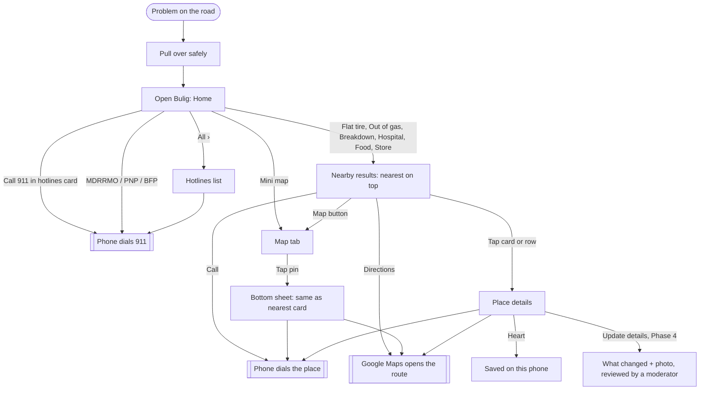

# Bulig UI and UX

How Bulig looks, how people move through it, and why. This is the source of truth for screens and flows. [ROADMAP.md](ROADMAP.md) says *when* each part ships, and [ARCHITECTURE.md](ARCHITECTURE.md) says *how* it is built.

Last updated: 2026-10-29 · Owner: John · Visual direction: **Modern Utility Minimalism**.

This revision uses the Graphite theme (it replaced Ocean Depths on 2026-10-29) and standardises the interface around a single type family, one icon family, clear surface boundaries, and a dedicated emergency-red action. It describes the target UI to implement; it does not claim that the existing components have already been changed.

Visual references (private, John's account): [System Map](https://claude.ai/artifact/3CX8HnRHESS9DT4oyuycKS) (flow and wireframes), [Nearby Results mockup](https://claude.ai/artifact/UH8x588qpo7yyHW9NM5VPr) (high-fidelity results screen), and [Bulig App Design](https://claude.ai/artifact/Pvr4j7BMVZZB4WfMmmKSiR) (original Ocean Depths theme). The [style board](design/style-board.png) shows the target look. Use this document's tokens and rules where the style board or an older visual reference disagrees.

Bulig covers the whole Philippines, then any country. Town names in the wireframes below are placeholders, not a pilot list.

**Where the app is now (2026-11-02; read this first in a new conversation):**

| Area | Built and live on `main` |
| --- | --- |
| Theme | **Graphite**: near-black, zinc greys, white; light and dark. Red only for Call 911 and emergency actions, green only for checked. See [§10 Theme: Graphite](#theme-graphite-current-2026-10-29). Ocean Depths is retired. |
| Navigation | **No top bar** and no logo tile: content starts at the top of the screen. Four tabs: Home `/`, Services `/services`, Map `/map`, Saved `/saved`. **Profile is not a tab** (John, 2026-11-04): the avatar on the right of Home's header opens it. **Emergency is not a tab:** a red hazard button floats on every screen and opens `/emergency`; Back returns. Bottom bar on phones, rail on tablets, sidebar (with the word "Bulig") on desktop. Offline shows a slim strip at the top. |
| Location | GPS finds the area by itself (`watchPosition`), asked only once you are in the app (never on the sign-in screens or over the splash); until the first fix, places show skeletons. **Shown on Home between the bento and the 911 card** (and on Emergency) as one plain text line between hairlines: "Lahug · Cebu City · Cebu · 6000" over "Updated 2:41 PM", with a reload button right after it. Address from OpenStreetMap Nominatim. Area picker in the same spot only when GPS is off. |
| Home | "What do you need?" bento = the **"What's wrong?" buttons**: each tile is a problem (Flat tire, Breakdown, Out of gas, Hospital, Food, Hotel, Store, Others) over the kind of place that solves it, and opens **Nearby results**. Then the location line, the national hotline (Call 911), local numbers, nearest places, Saved. |
| Map | MapLibre + OpenFreeMap (free, no key), recoloured to Graphite light/dark; category pins, chips, a place sheet. **In-app routes** from OSRM on OpenStreetMap roads (FOSSGIS, free, no key): a blue line, distance and time, Car or Walk, rerouting as you move, and a Google Maps button for voice navigation. Card **Directions** open `/map?to=<id>`. See [Map](#map-map). |
| Accounts | Everything but Emergency needs an account ([Accounts and access](#accounts-and-access-decided-by-john-2026-10-30)). [Login](#login-login), [Sign up = onboarding](#sign-up--onboarding-signup) with Ropi, [Forgot password](#forgot-password-forgot-password). No guest mode (John, 2026-11-04); `/emergency` still opens without an account from a shared link. Test logins (typed, no shortcuts): `test@`, `moderator@`, `admin@bulig.com` / `password`. Sign-ups are users kept on the phone (hashed password). |
| Profile | Production-style settings: your photo (or Ropi), role, member since, edit profile (photo, name, mobile, home area), change password, theme (System/Light/Dark), install, help, About, Terms, Privacy, sign out, delete account, "Bulig v0.3.0 · build <commit>". |
| Mascot | Ropi on quiet screens only, now **talking** in speech bubbles (`RopiSays`): login (head mark / side panel), onboarding (all four poses), forgot password, guest gate, Saved empty ("Let's get started!"), empty category, offline, map offline, page not found, About, Profile avatar. Never on Home or Emergency. See [Mascot: Ropi](#mascot-ropi). |
| Loading and motion | A **splash** (logo, "Bulig", "Help along the way.") on opening, never in front of Emergency. Pages **fade in** (160ms, none on Emergency and the Map) and open at the top; Back returns to the exact scroll position. **Skeletons** in the real layout while data or the first location loads. Works on iOS 14+, Chrome 87+ and in-app browsers. See [§7 States](#7-states-to-design) and [§10 Motion](#motion-touch-forms-and-browser-chrome). |
| Not built yet | The mini map strip on the nearest card, Update details (SCRUM-30), real backend sign-in and reset emails (Phase 4). |

The change history is in [CHANGELOG.md](CHANGELOG.md) under **Unreleased**.

**Current implementation baseline:** the v0.3 work has the Graphite palette (above) and a five-tab navigation (Home, Services, Emergency, Saved, Profile). The **target UI in this document** consolidates navigation to four tabs: Home, Map, Saved, Profile. Emergency actions live on Home and the Hotlines screen; Services remains a supported route and entry point, not a bottom tab. The Map tab and the six “What's wrong?” actions still need implementation. Preserve existing routes and data contracts while moving to the target UI.

---

## 1. The one job

Something goes wrong on the road. The person pulls over, opens Bulig, and in one or two taps is calling the nearest place that can fix that exact problem, or 911.

Every screen is judged against that sentence. If a feature doesn't make that faster or more trustworthy, it waits.

**Who it's for:** every driver and rider: motorcycles, cars, tricycles, trucks. Locals and people passing through.

**Where it's used:** on a cheap Android phone, outdoors in sunlight, often on weak or no signal, by someone stressed and in a hurry.

## 2. Problem to answer

| Problem | What Bulig shows | Data |
| --- | --- | --- |
| Flat tire | Nearest vulcanizing shops and air pumps | `tire_repair`, features `tubeless`, `air_pump`, `comes_to_you` |
| Out of gas | Nearest gas stations, then stores selling bottled fuel | `fuel`, feature `bottled_fuel` |
| Breakdown | Nearest mechanics, by vehicle type | `mechanic`, features `motorcycle`, `car_truck`, `comes_to_you` |
| Hurt or sick | Hospitals with an emergency room first, then clinics and pharmacies | `hospital`, feature `emergency_room` |
| Accident or danger | 911, then the town's MDRRMO, PNP, BFP, health unit and hospital | `EmergencyContact` |
| Hungry, need supplies | Nearest carinderias, restaurants and stores | `food`, `store` |

## 3. Navigation

Four bottom tabs, each with a Phosphor icon and a visible label:

| Tab | Route | Purpose |
| --- | --- | --- |
| Home | `/` | Hotlines card, "What's wrong?" buttons, mini map |
| Map | `/map` | Every place as a pin around you, with filters |
| Saved | `/saved` | Places and numbers the person hearted, kept with their sign-in on the phone |
| Profile | `/profile` | Sign-in (a test login for now), language, location, offline data, my updates (Phase 4), "Something's not working" (Phase 4), About |

Screens opened from a tab (no tab of their own):

| Screen | Route | Opened from |
| --- | --- | --- |
| Hotlines | `/hotlines` | Home hotlines card, "All ›" |
| Nearby results | `/nearby/:need` (`flat-tire`, `out-of-gas`, `breakdown`, `hospital`, `food`, `store`) | Home buttons |
| Place details | `/place/:id` | Any card, row, or map pin |
| About and privacy | `/about` | Profile |

**Permanent links:** `/services` and `/about` were shared in v0.2 and must keep working. `/about` stays as the About page. `/services` shows the Nearby results with every category ("All").

## 4. User flow



Bulig never sends help and never shares the exact location (only a rounded one, for the address; see section 6). Every outcome is the person's own phone making a call or opening directions.

## 5. Screens

### Home

**Built (2026-11-04, from John's Figma Make prototype "Bulig Roadside Help").** Design for the smallest supported viewport first: **360 × 740 CSS px**. Never shrink a touch target below 48px to force a no-scroll layout.

```text
┌────────────────────────────────┐
│ Hi John                   (JC) │  avatar opens Profile
│ ⌖ Sapao · Guiuan               │  live GPS location, one line
├────────────────────────────────┤
│ What do you need?      See all ›│  See all = Services
│ [Flat tire][Breakdown][Out of gas]│
│ [Hospital ][Food     ][Hotel     ]│  3 × 2 on phones, 6 in a row from 48rem
├────────────────────────────────┤
│ Nearest to you        Open map ›│
│ ┌────────────────────────────┐ │
│ │ live map: you + 5 pins     │ │  a picture: tap opens the Map tab
│ ├────────────────────────────┤ │
│ │ 3 nearest places, Call     │ │
│ └────────────────────────────┘ │
│ Local hotlines                  │
│ [ 911 card, red Call 911 ]      │
│ [ local numbers ]   All numbers ›│
│ Saved                  See all ›│
│ Pull over safely before using   │
│ your phone.                     │
├────────────────────────────────┤
│ Home  Services  Map  Saved      │  + the red hazard button, always
└────────────────────────────────┘
```

- **Header:** a small uppercase teal greeting by the phone's clock ("Good morning" 5:00–11:59, "Good afternoon" 12:00–16:59, "Good evening" 17:00–23:59, "Up late?" 0:00–4:59), then "**Hi, <first name>!**" in large type, then one short muted line that changes on each visit (`pages/welcome.ts`: picked when Home opens or you come back to it, or after 5 minutes away from the app; never the same line twice in a row; never claims Bulig sends help). Then the **live location** on one line: "Surok, Guiuan, Eastern Samar" (barangay, town, province from GPS; when OSM leaves the town or province off, the listed area the phone is in fills them; cut with "…" when long; no time, no refresh button: it updates by itself). While GPS is following the phone, a **green dot** with a slow ring stands in for the crosshair (screen readers hear "Live location:"); without a fix it is the crosshair. A faint teal winding road sits behind the right side of the header. On the right, a 44px avatar (photo, else **initials** on teal: Ropi never goes on Home) that opens **Profile**. Profile is not a tab (John, 2026-11-04): this avatar is the way in, and Profile has a **Back** button to Home. The four tabs share the bar's full width. Without GPS the location spot is the area picker ("Location is off. Pick your area"). No bell (there are no notifications yet) and no settings gear. A soft teal wash fades out behind it.
- **What do you need?:** the six commonest problems as tiles: Flat tire, Breakdown, Out of gas, Hospital, Food, Hotel. Each tile is one link: a 28px teal icon, the problem, and the nearest one's distance ("160 m"), else the count, else "None yet". No arrows: at 360px a tile is 104px wide and the whole tile is the target. Store and Others are under **See all** (Services).
- **Nearest to you** ("Near <area>" without GPS): one card with the **live mini map** on top and the three nearest places under it. The map is MapLibre with the same style, pins and blue dot as the Map tab, **centred on you** (it follows GPS and re-centres after any resize) and zoomed so the five nearest places fit around you, and not draggable (it never traps the page's scroll); tapping it opens the Map tab. It loads only once the card is on screen and the phone is idle, so Home and 911 never wait for it. Offline, without WebGL, or not drawn within 20 s, the map is left out and the list does the job.
- **Local hotlines:** the national 911 card (deep teal, red Call 911), with **All numbers** in the section head (like See all and Open map), then up to three verified local numbers. The red hazard button floats over every screen, so 911 stays one tap away even though the card sits lower on the page.
- **Saved:** up to three saved places, or "Sign in" / "Tap the heart".
- **Safety note:** "Pull over safely before using your phone." at the bottom.
- **Sizes:** side margins grow from 16px (360px phones) to 32px; sections are 24 to 32px apart; tiles 96px tall on phones, 108px from 30rem. From 60rem Home is two columns (nearest | hotlines and saved).

### Nearby results (`/nearby/:need`)

**Built (2026-10-30).** `/nearby/<need>` and the older `/services/<category>` render the same page (`NearbyPage.tsx`); needs live in `app/src/rules/needs.ts` (eight: the six below plus `hotel` and `others`). As built:
- **Back**, the need as the title ("Flat tire"), "3 vulcanizing shops near Cebu City, nearest first." (singular for one), and a **Map** button that opens the Map filtered to that kind of place (`/map?cat=<category>`).
- **Nearest to you** ("First listed" without GPS, with "Turn on location to sort by distance"): one big card with a stronger border: icon and distance in the display face, NEW / SAMPLE, heart, the name at 22px, type · landmark, "Usually <hours> · hours can change, call first", "Last checked <date>", and two 52px buttons: **Call** ("Call hospital" for hospitals) and **Route** (the in-app route on the Map).
- **More nearby:** one panel of rows: icon, name (taps open its route), type · distance · hours, and a call button.
- **Hospital:** a red-outlined note at the bottom, "**Life-threatening?** Call 911 now.", which opens Emergency.
- No results: Ropi `thinking` says "No <places> listed near <town> yet.", then See other services.
- One readable column (max 44rem) on wide screens.
- **Built (2026-10-30, second pass):** the **filter chips** per need (table below; a feature chip keeps places where it is confirmed, "Usually open now" keeps places usually open at this moment; several chips combine), the **status** line ("Usually open at this time · until 10 PM" in green, "Usually closed at this time · opens 6 AM tomorrow" in neutral grey, "Usually open 24 hours"), **feature tags** (✓ confirmed, "· Not confirmed" dashed when unknown, hidden when confirmed not offered), the amber-free grey **"Nearest usually open at this time: <name>, 1.1 km ›"** line under a closed nearest place, **hospitals with an emergency room first**, "No places match these filters" with **Clear filters**, and rows that open **Place details**. Rules: `app/src/rules/hours.ts` (`openStatus`, `describeStatus`, `hoursForDay`) and `rankForNeed()` in `needs.ts`, with tests.
- **Not built yet:** the mini map strip on the nearest card.

The original spec follows.

The same layout for every need, so people learn it once.

```
┌──────────────────────────────┐
│ ‹  Flat tire          [Map] │
│    Near <town> · 5 places    │
│ (Vulcanizing)(Air pump)(...) │  filter chips, preset by need
├──────────────────────────────┤
│ NEAREST TO YOU               │
│ ┌──────────────────────────┐ │
│ │ mini map: ◉ → pin  1.2km │ │
│ │ Sikad Vulcanizing [SAMPLE]│ │
│ │ Vulcanizing · Brgy 5      │ │
│ │ ● Usually open at this time│ │
│ │ ✓Tubeless ✓Air pump ?Comes│ │
│ │ Checked <date> · Call first │ │
│ │ [   CALL   ] [Directions] │ │
│ └──────────────────────────┘ │
│ MORE NEARBY                  │
│ ▣ Brgy 3 Air Pump   2.0km [☎]│
│ ▣ Mabini Tire Repair 3.1km[☎]│
└──────────────────────────────┘
```

- **Nearest card:** the first place after ranking. It shows a mini map strip (you and the pin), distance, name and SAMPLE badge, category and barangay, the open status, feature tags, the check date, and two 52px buttons: **Call** (filled teal) and **Directions** (outlined, opens Google Maps).
- **Feature tags:** “Tubeless” with a check when confirmed; “Comes to you · Not confirmed” in a neutral style when unknown. A feature that is not listed is not shown at all.
- **Nearest is usually closed at this time:** keep the card surface readable and show a neutral closed status, for example “Usually closed at this time · usual hours from 6 AM”. An amber line points to “Nearest usually open at this time: Seaside Grill, 1.1 km ›”. Nobody should drive to a locked door based only on a schedule estimate.
- **More nearby:** one rounded list. Each row has an icon, name, distance, a short feature note, the status, and a 48px phone button that calls without opening the place.
- **Map button:** shows the same results as pins on the Map tab.
- **Hospital:** use the hospital category icon and blue map pin, not the emergency-red token. The call button reads “Call hospital”, places with an emergency room rank first, and the footer reads “Life-threatening? Call 911 from Home.”

Filter presets:

| Need | Category | Chips |
| --- | --- | --- |
| `flat-tire` | `tire_repair` | Vulcanizing, Air pump, Tubeless, Usually open at this time |
| `out-of-gas` | `fuel` | Gas station, Bottled fuel, Usually open at this time |
| `breakdown` | `mechanic` | Motorcycle, Car/Truck, Comes to you |
| `hospital` | `hospital` | All, Emergency room, Clinic, Pharmacy |
| `food` | `food` | All, Carinderia, Restaurant, Usually open at this time |
| `store` | `store` | All, Convenience, Hardware, Usually open at this time |

### Hotlines (`/hotlines`)

- A red "Call 911" button at the top, then the town's numbers: MDRRMO, PNP, BFP, Rural Health Unit, hospital.
- Each row has the name, type, "Checked <date>", a SAMPLE badge when sample, and a phone icon on the right. Tapping anywhere on the row calls. No chevrons, because a chevron promises a details page.
- At the top: "Direct calls only. Bulig does not send help or share your location."
- Numbers last checked more than 180 days ago are hidden. The national number is never hidden.

### Map (`/map`)

**Built (2026-10-30).** Free forever: **MapLibre GL JS** draws the map, **OpenFreeMap** serves the tiles (no API key, no account, no fees), from OpenStreetMap data. No Google Maps SDK or paid tile plan. Directions hand off to the phone's Google Maps app by URL, which is free.
- The tab fills the space between the top bar and the tab bar, edge to edge. It centres on the blue location dot (zoom 14), else the area's centre (zoom 13), else the whole Philippines.
- **Styled in Graphite:** the OpenFreeMap `positron` style is recoloured layer by layer in `app/src/map/mapTheme.ts` (land, water, parks, buildings, roads, labels), with a light and a dark palette that follow the app theme. Blue is used only for the "you are here" dot and its soft halo.
- Pins: near-black circles with a white category icon (white with a black icon in dark mode), a small point at the bottom. The selected pin inverts and grows slightly.
- Filter chips across the top, one per category plus All, in a single scrolling row.
- Controls on the right under the chips: the red **emergency** button, then **Go to my location** (refreshes GPS and flies there).
- Tapping a pin opens a sheet at the bottom: name, type and distance, landmark, NEW / SAMPLE badges, heart, **Call** and **Route**, and a close button. Tapping the map closes it.
- **Route (in the app):** OSRM on OpenStreetMap roads, from the FOSSGIS servers at `routing.openstreetmap.de` (the ones openstreetmap.org uses): free, no key, fair use. A busy Bulig moves to its own OSRM with a Philippines extract. The route is a blue line (the same blue as the you-are-here dot) on a light or dark casing, fitted into view above the route sheet (phones) or beside it (tablets and up). The route sheet shows "Route to <place>", **distance · time** ("1.4 km · 3 min by car or motorbike"), a **Car / Walk** switch (motorbikes use the car route), **Google Maps** (opens Google for voice turn-by-turn) and **Call**, and an × to end the route. The route is asked for again when the phone enters a new ~200 m cell, so it follows a driver. Without a GPS fix: "Turn on location to see the route"; if the router fails: "Couldn't get a route right now. Google Maps can still guide you."
- **The route sheet, like navigation apps** (John, 2026-10-30): the corner button **minimizes** (⌄) instead of ending. Minimized, the route is a slim pill at the bottom (blue icon, place name, "1.4 km · 3 min", ⌃) while the line stays on the map; tap it to open the sheet again. Ending is deliberate: **End route** (red text at the bottom of the open sheet), or **swipe the pill sideways** past ~96px (a shorter drag snaps back). Right after, a dark pill says "Route ended · **Undo**" for 5 seconds. Tapping another pin while routing opens that place's sheet over the route; **Route here instead** switches the route, closing it returns to the route. The route (place and Car/Walk) is kept for the browser session (`bulig.route`), so leaving the Map and coming back keeps it.
- **Directions** on any place card opens `/map?to=<id>`: the Map with that place picked and its route on. No live traffic and no spoken directions in Bulig; that is what the Google Maps button is for.
- The map credit is always shown, as the licences require, but as one line of small muted text in the bottom-left corner ("© OpenMapTiles © OpenStreetMap", linking to openstreetmap.org/copyright) instead of MapLibre's "i" button and pop-up (John, 2026-11-04: "cleaner"). Home's mini map carries the same line; the full credits are on About.
- **Lighter drawing** (2026-11-04): the style is fetched and recoloured before the map is made (no flash of the stock colours), other businesses' icons and names, house numbers, road shields, one-way arrows and airport details are left out, the map draws at most 2x pixels on 3x screens, with no tile fade-in, no tilt and one copy of the world.
- MapLibre (about 270 kB gzipped) loads only when the Map tab (or Home's mini map) needs it, and is kept out of the install download, so Home and Emergency never wait for it. Once loaded, the service worker keeps it, with the map style and the last 500 tiles viewed (2026-11-04).
- **The map is made once per session** (`map/mapKeeper.ts`, 2026-11-04). Leaving the Map tab only takes the map out of the page; coming back puts the same map back, ready at once, at the view it was left at, with the route still drawn and following on or off as it was. One WebGL context for the whole session instead of one per visit. It is rebuilt only on Try the map again or a failed load.
- **Panning doesn't show blank squares** (`map/tilePrefetch.ts`, 2026-11-04). While the map is still, it fetches the tiles just off screen (and the screen one zoom out) into the service worker's cache. It stops when the map moves and never runs offline, on Data Saver or on 2G; at most 150 tiles a session (about 5 MB), because data costs riders money.
- **The first map of a session opens where the person last looked** (`bulig.mapView` on the phone, rounded to about 100 m), else on the person, else their area, else the whole country. A GPS fix moves an area view to the person once.
- **When the map can't be drawn**, Ropi `thinking` says why, then the nearest places as a list (2026-11-04: it used to say "needs a connection" for every failure):
  - offline: "No signal, so no map right now."
  - no WebGL (some cheap phones, Messenger and Facebook's in-app browsers): "This browser can't draw the map." plus "open it in Chrome instead".
  - the map file failed or nothing drew within 20 s: "The map didn't load." with **Try the map again**.
  - A map file missing after a deploy (a phone on the old version) reloads the app once into the new version.
- **Location off** (denied, failed or no GPS): a one-line strip under the chips says why there is no blue dot ("Location is blocked. Allow it for this site in your browser settings."); the map still centres on the area.

### Place details (`/place/:id`)

**Built (2026-10-30).** `PlacePage.tsx`: Back; kind · area; the name with NEW / SAMPLE and the heart; distance and landmark; the status line; 52px **Call** ("Call hospital"), **Route** and **Share** (the phone's share sheet, or "Link copied"); the number in text; **Usual hours** for the week from Monday with **Today** marked, and "Hours can change, especially on holidays. Call first." (or the reported text and "Usual hours aren't recorded yet. Call to check."); **What it offers** (✓ confirmed, struck through "No …" when confirmed not offered, unknown left out); **Checked** with the source; and "Open in Google Maps". Opened from Nearby rows and names, Saved card names, and **Details** on a map pin's sheet. The Services tab stays selected. Not yet: Update details (SCRUM-30, Phase 4, in the app).

The original spec:

- Name, category, barangay, distance, heart (save), SAMPLE badge.
- A compact verified row: "Checked <date> · <how>", for example "Field visit" or "Phone call", using a success icon/text rather than a large green panel.
- Services with Yes or "Not confirmed": tube-type, tubeless, air pump, motorcycle, car/truck, comes to you (whichever apply to the category).
- Usual hours for each day, with the check date and "Hours can change. Call first."
- "Update details" (Phase 4): a secondary button under the hours. The form asks "What changed?" (Prices, Hours, Services offered, Phone, Location, Closed for good, Something else), shows the current value next to each field it opens, then "Add a photo" (the price board or sign; required for prices, up to 3) and "When did you see this?" (today by default). Send → "Thanks. A moderator checks it before it shows." The person's submissions and their status are in Profile. Posts to `POST /uploads` and `POST /submissions` ([API.md §7](API.md#7-community-updates-update-details)). No Google Form, no Ropi on this form.
- Prices (Phase 4, fuel and later services): "RON 91 ₱82.00 · seen 30 Oct by a Bulig user". Greyed after 7 days, hidden after 30. Never "today's price" or "current price".
- A sticky bottom bar with Call and Directions.

### Saved (`/saved`)

- Hearted places and numbers, kept with the signed-in account on this phone, sorted by distance.
- Empty state: Ropi `friendly` says "**Let's get started!** Tap the heart on any place to save it here.", then **Find a place**.

### Accounts and access (decided by John, 2026-10-30)

- **Everything except Emergency needs an account.** Home, Services, Map, Saved and Profile sit behind `RequireAccount`.
- **Emergency (`/emergency`) is open to everyone, always:** signed in, guest, or a stranger opening a shared link. Nothing about calling 911 or local authorities ever waits on a login.
- Not signed in and not a guest: any other screen redirects to `/login?next=<that screen>` and returns there after signing in or signing up.
- **No guest mode** (removed 2026-11-04, John): anyone signed out goes to the login and back after. `/emergency` stays open without an account.
- Signing in or signing up clears guest mode.

### Login (`/login`)

- No tab bar, no header, no test shortcuts, no emergency button (John, 2026-10-30). It simulates the real product.
- **Phones:** Ropi's head in a circle (88px, tappable) tops the screen as the app mark, then "Welcome back" / "Sign in to find help along the way."
- **From 60rem (tablet landscape, desktop):** a split screen. Left: a quiet panel with Ropi `ready` waving (260px, tap for the reaction), "Bulig", "Help along the way." Right: the form.
- Form: Email, Password (show/hide), a full-width **Sign in**. Directly under the button: **Forgot password?**
- A divider "New to Bulig?", then **Create an account** (outlined, full width), which opens the onboarding.
- No guest mode and no emergency link here (John, 2026-11-04).
- Look (all sign-in screens): one card (24px corners, layered shadow, a light top edge in dark mode) on a soft teal glow. Ropi's head in a teal ring with a shield badge, a bold title, quiet labels, filled fields with placeholders, a solid teal main button with a teal lift, teal links, and form errors in a tinted box with an X. Footer under the card: "Bulig · Road help for the Philippines". Blocks stack in a beat apart; a field shakes once when it turns invalid, and the fields shake on a wrong password. All motion is off under reduced motion.
- The test logins still work when typed: `test@bulig.com`, `moderator@bulig.com`, `admin@bulig.com`, password `password` (see [WORKFLOW.md](WORKFLOW.md#sign-in)).

### Sign up = onboarding (`/signup`)

Ropi explains Bulig before the account form. Progress dots on the top left, **Skip intro** on the top right (steps 1–4), **Back** / **Next** at the bottom, "Already have an account? Sign in" under everything. Each step moves focus to its heading. One Ropi per screen, so the login's side panel is off here.

| Step | Ropi | Title | What it explains |
| --- | --- | --- | --- |
| 1 | `ready`: "Hi, I'm Ropi! I'll show you around Bulig." | Help along the way | What Bulig is (checked numbers and the nearest road services, anywhere in the Philippines); built around GPS |
| 2 | `friendly`: "Here's how it helps on a normal day." | Every day on the road | Flat tire → Vulcanizing, gas and mechanics nearest first, restos, hotels and **Others**, the heart to save |
| 3 | `thinking`: "Why use Bulig and not just search?" | Why Bulig | Checked with dates, works with no signal, free with no ads or paywall near 911 |
| 4 | `head`: "One last thing: staying safe." | Safety first | The red button on every screen; pull over first (RA 10913); Bulig never sends help or location |
| 5 | `friendly`: "Let's get started! Make your account." | Create your account | Name, Email, Password (8+), "I agree to the Terms of Use and Privacy Policy" (required), **Back** / **Create account** |

After **Create account** the person lands on Home (or the screen that asked for sign-in).

### Forgot password (`/forgot-password`)

- Ropi's head mark, "Forgot your password?", Email, **Send reset link**, "Back to sign in".
- Then Ropi `friendly`: "**Check your inbox.** If <email> has an account, a reset link is on its way." It never says whether the email has an account.
- Preview note under it: "Reset emails start when accounts move online. Nothing was sent from this phone." Remove it when Phase 4 sends real emails.

### Emergency (`/emergency`)

- Not a tab. A **red round button with a hazard icon** floats bottom right on every screen (above the tab bar on phones), and the Map has the same red button in its control stack. It opens Emergency.
- Emergency has **Back** at the top, which returns to the previous screen. When Emergency is the first page of a visit (a shared link), a signed-in person sees **Home** instead; others see neither.
- Content as before: the national hotline card (911), local numbers for the area, checked dates. Without an account, a note at the bottom: "You're using Bulig without an account. Nearby services and the map need one." with **Sign in**.

### Profile (`/profile`)

Built like a production settings screen:
- **Header card:** the person's photo as the avatar (Ropi's head until they add one), name, email, a role badge (User / Contributor / Moderator / Admin), "Member since <month year>". (No Profile tab since 2026-11-04: Home's header avatar, with initials instead of Ropi, opens this page.)
- **Account:** Edit profile (`/profile/edit`: **photo** (Add a photo / Change photo picks a picture, centre-cropped to a 256px WebP of about 15–30 KB, then shows a big round **preview** with "Use this photo?", **Use this photo** / Choose another / Cancel; it saves to the account only on Use this photo. **Remove** asks "Remove your photo?" with Remove photo / Keep it), name, email read-only (changed on its own page), optional mobile number checked as a PH number, optional **home area as free text** up to 120 characters ("e.g. Surok, Guiuan, Eastern Samar", with the listed areas as suggestions, so a new barangay or town still fits; "Your barangay and town are enough. Don't enter your house address.")), Change password (`/profile/password`: current, new, confirm; test logins can't change theirs), Change email (`/profile/email`: new email and current password; a link goes to the new address and nothing changes until it is opened at `/confirm-email`; the row says "Waiting for link" meanwhile, with Cancel the change), Saved places with the count, Home area when set.
- **Preferences:** Appearance (System / Light / Dark, remembered and applied before the first paint), Language (English), Location (Allowed / Blocked / Not asked yet, from the phone's permission).
- **App:** **Install Bulig**: the browser's install prompt on Android/Chrome, or the Share → Add to Home Screen steps on iPhone. Hidden once installed. Offline data: "<n> places · <n> numbers".
- **Support and legal:** Help and FAQ (`/help`), About Bulig (what it does, how it works, checked information, what it is not, credits), Terms of Use (`/terms`, nine sections), Privacy Policy (`/privacy`: what is collected and why, location, where data is kept (Neon and Render in Singapore, Cloudinary, Brevo), how long, your rights under RA 10173). No licences page since 2026-11-04 (John): `/licenses` redirects to About, whose Credits section carries the map and software credits. Help, Terms and Privacy are open without an account (sign-up links to them).
- **Back** on every sub-page (Profile, its sub-pages, About, Help, Terms, Privacy) stays pinned at the top while the page scrolls.
- **Busy buttons:** every submit button (Sign in, Create account, Send reset link, Save changes, Change password, Send the link, Save new password, Use this photo) shows only a spinning ring while it waits, at the same size; screen readers hear "Signing in…" and so on.
- **Sign out** (outlined, full width), then back to the login.
- **Delete account:** for accounts made on this phone. Typing "delete" enables the red-outlined button; it removes the account, its saved places and details. Test logins say they can't be deleted.
- **Footer:** "Bulig v0.3.0 · build <commit>" (version from `package.json`, build from the deploy's git commit), "Made for travellers in the Philippines."
- Terms and Privacy are **drafts** with a visible "needs legal review" note. They describe what the app really does today (what stays on the phone, what goes to Nominatim, OpenFreeMap and Google Maps, RA 10173).

### Others: new and local businesses

- A category, `other`, labelled **Others**: "New stalls and local finds" (halo-halo, BBQ, fishball, coffee kiosks, buko juice, lechon manok, merienda, pancit).
- On Home it closes the bento as a **wide tile** (two columns on phones, the last two of four on tablets and up), with a **NEW** badge when any place in it is new. On Services it is the last card.
- A place shows its own word (`Service.subtype`: "Halo-halo") instead of the category name, on cards, rows and the map sheet.
- **NEW** (black pill, white text) on places listed in the last 60 days (`Service.addedAt`). It never changes the order: nearest still comes first. If paid placement ever comes, it gets a separate, clear "Sponsored" label.
- Others never appears on Emergency or near the hotline.

### Installed, full screen

- A website can't hide the browser's address bar by itself. Installing Bulig (Profile → Install Bulig, or the browser's Add to Home Screen) opens it full screen, with no address bar, like any app.
- The manifest uses `display: standalone`, `id` and `scope` `/`. `index.html` adds `apple-mobile-web-app-capable` and `mobile-web-app-capable` so iPhones open the installed app full screen too.

## 6. Rules for every screen

**Safety and trust**
- 911 is always one tap from Home. There's never a login, ad or paywall on anything to do with emergencies.
- Copy never says "request help", "help is on the way" or "location sent".
- Every place and contact shows its check date. Sample records show a grey SAMPLE badge until real data replaces them.
- "Pull over safely before using your phone" appears on Home. Bulig is designed for use when stopped, never in motion (RA 10913, the Anti-Distracted Driving Act).
- Hours are described as "Usually open at this time" or "Usually closed at this time", never as a live "Open now" guarantee, because they are reported schedules.

**Built for a low-cost phone in sunlight**
- Body text is 16px; metadata is normally 14px, and no essential text is below 13px. Inputs use at least 16px.
- Interactive targets are at least 48 × 48px. Call 911 and primary Call actions are visually prominent and easy to hit.
- Verify each actual foreground/background pair against WCAG AA. Normal text needs 4.5:1; large text and necessary control/state visuals have their respective WCAG thresholds. Do not claim the entire palette passes based on a few sampled pairs.
- Use one self-hosted font family, precached for offline; no runtime font request leaves the app.
- The theme is Graphite: near-black, greys and white (see [Theme: Graphite](#theme-graphite-current-2026-10-29)). Emergency actions are red. Amber means caution or stale information. Green means verified/success. Grey means closed or unconfirmed. Never use colour as the sole carrier of meaning.
- Card edges use a visibly stronger neutral border. Functional controls use a separate control-border token with at least 3:1 contrast against their adjacent surface where WCAG 1.4.11 applies. Test the app outdoors on a real low-cost Android device; a calculated ratio is not a sunlight test.

**Fast and offline**
- Home, Hotlines and Nearby results work with no signal after one visit. The map is the only part that needs a connection for new areas.
- When offline, a thin banner reads "Offline: showing saved info".
- Nothing heavy loads before 911 is on screen.

**Location**
- Location is asked for when the app opens and then followed while it stays open (`watchPosition`), so the area updates as the driver moves. A refresh button next to the area asks for a fresh fix. There is no area search. (This replaces "ask on first use": John decided on 2026-10-29 that the area should find itself.)
- If location is denied, missing or failing, the same spot becomes a plain area picker, and places sort by name.
- Distances only show when location is known. The exact position never leaves the phone.
- **Address:** the location line on Home (and Emergency) shows the full address, "Lahug · Cebu City · Cebu · 6000", with "Updated <time>" and a reload button. Missing parts are left out (an independent city may have no province). The address comes from OpenStreetMap's free Nominatim reverse lookup, sent a position rounded to about 110 m, only when online, and again only after a 250 m move or a refresh; the last one is cached on the phone. Without it, the line shows the nearest listed area and its region.
- Profile says plainly what is shared and when.

**Ranking (Nearby results)**
1. Hospital: places with `emergency_room` first.
2. Then by straight-line distance from the person (places without coordinates go last).
3. Without location: by name, within the picked town.
4. Nearest-usually-open is worked out separately, for the "Nearest usually open at this time" line.

## 7. States to design

| State | What shows |
| --- | --- |
| Asking for location | Only once the person is in the app: never on Sign in, Create account or Forgot password, never over the splash. Until the first fix (while the prompt is open), places hold their skeleton instead of listing every area and then jumping to the nearest, for up to 8s; a saved area shows at once. |
| Loading | A skeleton in the shape of what is coming (the "What's wrong?" tiles, rows, cards, Place details), using the real layout so nothing jumps when the data lands. Hidden for the first 100ms, so a fast load shows nothing; a slow opacity pulse, still under reduced motion. One "Loading…" for screen readers. The national hotline never waits behind one. On Ropi pages, Ropi walks over the skeleton once the wait passes 1.2s. |
| Data failed to load | "Couldn't load data" with **Try again**, never an endless "Loading…". |
| First open, no location yet | The picked town (default: all areas). The prompt appears only on first use of a button or the Map. |
| Location denied | The town picker stays the source of truth, sorted by name, with a one-line hint. |
| Page not found | Any unknown path, category or place. "Page not found", "The link may be old, or the place was removed.", then Ropi `thinking` says "**This road doesn't go anywhere.** Let's get you back on track.", a **Go home** button and an **Emergency hotlines** link (Home needs an account; Emergency never does). No animation file (John chose Ropi over a LottieFiles animation, 2026-11-04). The hazard button stays. |
| Offline | The banner. Cached data everywhere, and the mini map swaps to the plain panel. A screen that has nothing cached shows Ropi `thinking` with "No signal, and nothing saved here yet." |
| No results for a filter | Ropi `thinking`, then "No places with <filter> near <town> yet." plus a "Clear filters" button and "Know one? Tell us" (opens the Form). |
| Nearest is usually closed | A neutral closed status plus the amber "Nearest usually open at this time" line. |
| Data older than 30 days on the phone | Profile's offline row turns amber: "Updated 34 days ago, connect to refresh." |
| Expired emergency number | Hidden. The national number is never hidden. |

## 8. Not in the UI yet, and when

| Feature | When | Why not now |
| --- | --- | --- |
| Ratings and reviews | Phase 5, if John decides so | Needs accounts, a backend and enough users to mean anything. The check date is the trust signal until then. |
| Alert when near a saved place | Phase 6 (Android app) | Browsers can't track location in the background. |
| Places along my route | Phase 7 | Needs a routing engine and a connection. |
| Real sign-in, owner portal, moderator and admin screens | Phases 4 and 5 | The admin panel is Filament, which brings its own UI. A test sign-in ships now, only so saving can be tried. |
| Live "Open now" | Only if owners update their status | Reported hours can only say "usually". |
| Dispatching help, live tracking | Never | It would be a false safety promise. |

## 9. Data the UI needs

All additive and optional, so contract v1 stays (see [ARCHITECTURE.md](ARCHITECTURE.md#1-data-contract)):

- `Area.lat`, `Area.lng`: the town centre, used to detect the town from GPS (nearest centre) and to centre the map when location is off.
- `Area.level` and `Area.parent`: the country's word for the area (`city`, `municipality`, later `barangay`) and the area it sits inside, so barangays can be added as data and moderators can look after an area and everything in it ([WORKFLOW.md](WORKFLOW.md#areas)). Already in the data.
- `Service.features`: confirmed features as `Partial<Record<Feature, boolean>>`. `true` means confirmed, `false` means confirmed not offered, and a missing key means not confirmed.
- `Service.weeklyHours`: per-day open and close times, for example `{ "mon": [["07:00", "18:00"]] }`. `Service.open24h` is for hospitals. The old free-text `hours` stays for display until every record is converted.
- `Service.subtype` (optional): for chips like Carinderia vs Restaurant, Clinic vs Pharmacy.

Features: `tubeless`, `tube_type`, `air_pump`, `comes_to_you`, `motorcycle`, `car_truck`, `bottled_fuel`, `emergency_room`.

## 10. Visual design: Bulig Teal · Modern Utility Minimalism

### Design direction

**Style:** modern utility minimalism with restrained flat design. The interface should feel like a dependable roadside tool—not a dashboard template, a marketing landing page, or a visual-effects demo.

- Calm page background, white cards, dark readable text, deliberate colour only for actions and meaningful status.
- No gradients, glassmorphism, neumorphic inset shadows, clay-like cards, decorative glows, stock illustrations, or oversized hero panels on task screens.
- Cards are separated mainly by border and spacing, not by piles of shadows. Reserve a subtle shadow for floating UI such as a map bottom sheet when elevation explains layering.
- The wordmark is compact. Content—not branding—gets the space on Home.
- Keep Home focused on emergency access, local hotlines, the six roadside needs, and an optional map preview. Do not turn it into a bento dashboard with large unequal cards.

### Typography

**Built (2026-11-04).** Use **IBM Plex Sans** as the single UI family for headings, body, buttons, numbers, status, and navigation. This gives the product one consistent typographic voice and removes the previous Lexend / Source Sans 3 split. Use tabular numerals for phone numbers, distances, and timestamps when supported.

Suggested self-hosted setup for this React app:

```bash
npm install @fontsource-variable/ibm-plex-sans
```

Load the bundled local font once in the app entry point:

```ts
import "@fontsource-variable/ibm-plex-sans";
```

CSS family name and number styling:

```css
font-family: "IBM Plex Sans Variable", "IBM Plex Sans", system-ui, sans-serif;
font-variant-numeric: tabular-nums;
```

Keep the required font files in the build and precache them for offline use. Do not load Google Fonts or any other font CDN at runtime. If local font packaging is changed, verify the emitted family name and the network panel in a production build before removing the fallback.

| Element | Size | Weight | Notes |
| --- | ---: | ---: | --- |
| Page heading | 24px | 600 | One clear title; avoid giant hero text |
| Section heading | 18px | 600 | “What's wrong?”, “Nearby” |
| Service name | 17–18px | 600 | Wrap rather than clip |
| Body and instructions | 16px | 400 | Main reading size |
| Primary button | 16–18px | 600 | Verb first, explicit action |
| Status / distance | 14px | 500–600 | Label + icon where useful |
| Secondary metadata | 13–14px | 400–500 | Never use for essential instructions |

Use line-height around 1.4–1.5 for body content. Avoid thin weights, excessive letter spacing, long uppercase labels, and relying on colour alone for text hierarchy.

### Icons

**Built (2026-11-04).** Use one icon family: **Phosphor Icons for React** (`@phosphor-icons/react`), replacing `lucide-react` in the target UI. Official package: [Phosphor Icons React](https://github.com/phosphor-icons/react). Install with:

```bash
npm install @phosphor-icons/react
```

Use the `regular` weight for most icons. The `fill` weight marks the selected tab and a saved heart (built); don't mix unrelated styles. Prefer named imports so the bundle can be tree-shaken. If development builds become slow from processing the entire icon package, use the package's documented per-icon imports.

- Navigation icons: 20–22px.
- Category and prominent action icons: 22–24px.
- Inline metadata icons: 16px, only when they remain legible.
- Map pins: one recognisable category icon inside the marker.
- Every icon-only button has an accessible name (`aria-label` or visible equivalent). Decorative icons are hidden from assistive technology. A visible label accompanies every unfamiliar service-category icon.
- Do not use emojis as UI icons. Do not combine Phosphor, Lucide, Material Symbols, and hand-picked third-party sets in the same interface. A custom SVG is permitted only when the chosen library has no clear symbol for a concept such as a flat tire.

### Theme: Bulig Teal (current, 2026-11-04)

On 2026-11-04 John chose an **identity pass** over Graphite, after feedback that the app looked like a generic AI build: all greys, the stock icon kit, nothing local. Same screens and layout; the skin now carries the brand. **Teal** from the Bulig logo and Ropi's scarf is the brand colour for actions, links, selected states and category icons. **Red** stays for emergency actions only, **green** for checked, greys for everything else. Map pins keep their own category colours ([Map pins](#map-pins)). (Graphite, 2026-10-29 to 2026-11-04, used near-black as the brand colour.)

Token source: [`app/src/index.css`](../app/src/index.css), in three layers (primitive `--zinc-*`, `--teal-*`, `--red-*`, `--green-*`, `--pin-*` → semantic `--color-*` → component `--button-*`, `--hotline-*`, `--tab-*`). Components use semantic or component tokens only.

| Role | Token | Light | Dark | Use |
| --- | --- | --- | --- | --- |
| Page ground | `--color-bg` | `#FAFAFA` | `#09090B` | App background |
| Surface | `--color-surface` | `#FFFFFF` | `#18181B` | Cards, forms, navigation |
| Main text | `--color-text` | `#18181B` | `#FAFAFA` | Headings and body |
| Secondary text | `--color-text-muted` | `#52525B` | `#A1A1AA` | Supporting information |
| Card border | `--color-border` | `#E4E4E7` | `#27272A` | Card edges, dividers |
| Control border | `--color-border-strong` | `#71717A` | `#71717A` | Inputs and chips (WCAG 1.4.11) |
| Primary action | `--color-primary` | `#0E7490` | `#22D3EE` | Normal Call, Sign in, chips, selected states |
| On primary | `--color-on-primary` | `#FFFFFF` | `#05222A` | Text and icons on primary |
| Brand text | `--color-primary-text` | `#155E75` | `#67E8F9` | Links, Back, active tab icon, category icons |
| Selected / soft fill | `--color-selected` | `#ECFEFF` | `#0C3A47` | Active tab pill, feature tile, segmented track |
| Hotline card | `--color-deep` | `#05222A` | `#05222A` | National hotline card |
| Emergency action | `--color-emergency` | `#DC2626` | `#DC2626` | Call 911 and every emergency action, nothing else |
| On emergency | `--color-on-emergency` | `#FFFFFF` | `#FFFFFF` | Label on the red button |
| Checked | `--color-checked` | `#15803D` | `#4ADE80` | "Checked <date>" |
| Error | `--color-error` | `#B91C1C` | `#F87171` | Form errors |
| Sample badge | `--color-sample-bg` / `-text` | `#EBEBED` / `#3F3F46` | `#27272A` / `#E4E4E7` | SAMPLE badge, test notices |

Measured contrast (WCAG), teal: white on primary `5.36:1`; brand text on white `7.27:1` and on the selected fill `6.99:1`; dark on-primary on primary `7.88:1`; dark brand text on surface `12.22:1`; the red Call 911 button against the hotline card `3.43:1` (1.4.11), its white label `4.83:1`. Unchanged from Graphite: light text on page `16.97:1`; secondary text on white `7.73:1`; white on primary `17.72:1`; white on emergency red `4.83:1`; checked on white `5.02:1`; error on white `6.47:1`; control border on white `4.83:1`. Dark: text on page `19.06:1`; secondary on surface `6.91:1`; checked on surface `10.17:1`; error on surface `6.40:1`; control border on surface `3.67:1`. Still test outdoors on a real low-cost phone.

- Ordinary Call buttons are the brand teal. Only Call 911 and emergency actions are red, so red always means emergency.
- The national hotline is a deep-teal card (`#05222A`) with a red Call 911 button. It replaces the earlier pale-red card in "Component rules"; the hotline must stay the strongest block on Home.
- Shape: cards 14px corners, controls 10px. Borders separate surfaces; no shadows except the selected segmented tab's 1px ring.
- `theme-color`, the PWA manifest and the app icons use `#FAFAFA` / `#09090B`. The app icons are the Bulig logo (teal pin, road and hand) on white, generated from `app/brand/bulig-icon.png`.

### Language

English only for now (John, 2026-11-04). The short Filipino lines added in the identity pass were removed the same day; a full Filipino translation stays on the roadmap.

### Map pins

Use the following as the fixed category mapping. The set is a deliberate visual system, **not a claim of a mathematically optimal colour-blindness solution**. Keep icons, labels, and accessible names so category and status do not depend on colour alone.

| Category / state | Pin colour | Icon colour | Meaning |
| --- | --- | --- | --- |
| Flat tire / tire repair | `#1E293B` | `#FFFFFF` | Charcoal |
| Gas / fuel | `#0E7490` | `#FFFFFF` | Brand teal |
| Mechanic / breakdown | `#6B21A8` | `#FFFFFF` | Deep purple |
| Hospital | `#0072B2` | `#FFFFFF` | Blue, kept separate from emergency red |
| Food | `#F59E0B` | `#0B2530` | Amber; food icon |
| Store | `#F59E0B` | `#0B2530` | Amber; store icon |
| Closed / not usually available at selected time | `#9AA5AB` | `#0B2530` | Grey status treatment; category icon/label remains available |
| User location | `#1677FF` | `#FFFFFF` | Round blue dot with a pale pulsing halo, never a category-shaped pin |

- Give every map pin a 2px white ring and a 1px dark outer outline so it separates from light and dark map tiles. **Built (2026-11-04)** in `MapPage.module.css` (`data-category` on each pin); hotels and Others use `#3F3F46`.
- Food and Store intentionally share amber because both are non-urgent supplies; their icons and labels distinguish them.
- Hospital pins are blue. Reserve red for the emergency-call action; a hospital category must not make ordinary browsing look like an emergency.
- A closed pin may be muted grey, but keep its category glyph and visible status text. Never hide a place or imply live availability solely from its colour.
- Test pins on the actual map style in normal vision and protanopia/deuteranopia simulations. If two categories still collide, first strengthen icon/label differentiation rather than inventing more colours.

### Layout, shape, and surfaces

- Spacing scale: 4, 8, 12, 16, 24, 32px. Standard phone gutter: 16px.
- Cards: 12px corner radius, white surface, 1px neutral border. Avoid a shadow on every card.
- Buttons and inputs: 10px corner radius. Primary buttons: at least 48px high; main emergency/Call actions: 52–56px high.
- Category tiles: consistent dimensions, a single Phosphor icon in brand teal (vulcanizing is Phosphor's `Tire`), short visible label, and neutral icon backing. Do not give each category its own decorative card colour.
- Chips: compact, lightly bordered, selected state clearly indicated. Avoid turning every filter into a saturated pill.
- Bottom navigation: four evenly spaced items, icon plus label, visible selected state. Avoid a large floating centre button that blocks map content.
- Borders carry most card separation. A subtle shadow is allowed only where elevation is meaningful, such as a map bottom sheet or modal.
- Use `max-width: 48rem` for narrow content; responsive layouts may expand on tablets and desktops without making mobile cards wider than necessary.

### Component rules

- **Hotline card:** pale-red surface, red border, dark-red title, a full-width red Call 911 button. Quick local contacts are separate, compact calls. The national hotline is never hidden.
- **Normal call:** brand teal fill with white text in light mode (light teal with deep-teal text in dark); do not reuse the emergency token. “Call” opens the phone dialer for that specific published number.
- **Directions:** outlined neutral control; opens Google Maps and does not look like the primary/emergency action.
- **Service category tile:** one icon + label; consistent size and padding. Do not show arbitrary per-category backgrounds.
- **Service card:** name and distance first, category/barangay next, “Usually open at this time” or “Usually closed at this time”, feature confirmation, last-checked date, then Call and Directions.
- **Verified data:** compact green icon/label with date and method. SAMPLE data always has a separate neutral SAMPLE badge.
- **Warnings:** amber text on a pale amber surface in light mode. Explain the issue in words and state the next action.
- **Offline:** one subtle header banner/pill saying “Offline: showing saved info”. Do not let the banner push Call 911 off-screen.
- **Empty state:** one clear explanation and one useful next action. The only illustration allowed is Ropi, the mascot, under the rules in [Mascot](#mascot-ropi).

### Mascot: Ropi

Ropi is Bulig's mascot: a golden-tan dog with cream markings, a charcoal helmet with blue goggles pushed up, a teal scarf (`#0E7490`) and a dark-green backpack. Ropi makes the quiet screens friendlier. Ropi is not the logo, not an icon, and never part of getting help.

**Where Ropi goes, and where never**

| Pose | File | Used on |
| --- | --- | --- |
| Ready (sitting, waving) | `ropi-ready.webp` | Login side panel (60rem+), onboarding step 1, About |
| Friendly (standing, tail up) | `ropi-friendly.webp` | Saved empty state, onboarding step 2 and the account form, forgot-password confirmation |
| Thinking (paw on chin) | `ropi-thinking.webp` | No results, offline with nothing cached, Map offline, guest gate, onboarding step 3 |
| Head (round crop) | `ropi-head.webp` | Login and forgot-password mark on phones, Profile avatar, onboarding step 4; only inside a circular frame |
| Walking (8-frame loop) | `ropi-walk.webp` | Loading, on Services, a category and Saved (later the Map while it loads) |

- **Never** on Home, Hotlines, the Call 911 card, the "What's wrong?" grid, Nearby results lists, Place details, or the Map itself (its offline list may show Ropi). Those screens are for getting help fast.
- **Never** as a reaction to tapping a card, a Call button, or any other control. A tap on a control does its job at once.
- One Ropi per screen, at most 160px tall on a phone, placed above the empty-state text (or under its speech bubble), never beside or over a button.
- Add a new pose only when a real screen needs it. Every pose must keep the same face, colours, outfit and art style.

**Status (2026-10-30):** built. `app/src/components/Mascot.tsx` (`variant`, `height`, tap reaction) and `RopiSays.tsx` (Ropi under a speech bubble with a tail; the bubble is real text for screen readers, Ropi stays decorative). Used on every screen in the table above. `RopiLoader.tsx` shows the walking loop (96px) over the loading skeleton (`Skeleton.tsx`) on Services, a category and Saved, after 1.2s; Home and Emergency show only the skeleton.

**Files**
- Stored in [`app/public/assets/mascot/`](../app/public/assets/mascot/), served from `/assets/mascot/<name>.webp`. Naming and export rules are in that folder's README.
- Transparent WebP, trimmed to the character, longest side 480px, about 30–40 KB each. No text, props, shadows or backgrounds baked into the image.
- WebP is in the service worker's precache list, so Ropi shows offline after the first visit.
- Rendered as ``. Ropi is decorative: `alt=""`, and the screen's text carries the message.

**Motion: only when tapped**
- Ropi stands still by default. This follows the rule below of no decorative entrance animation and no continuous movement.
- Tapping Ropi plays one short reaction, under 600ms, then stops: a wiggle or hop, plus small floating icons drawn in code (not in the image). Thinking gets a "?" and a lightbulb, friendly gets hearts, ready gets sparkles. The icons come from the app's icon set.
- Only `transform` and `opacity` are animated, so it stays smooth on a low-cost phone.
- With `prefers-reduced-motion`, there is no movement; a tap may show the icons without motion.
- **The one exception is loading.** While a page with Ropi is loading, Ropi walks in a loop: `ropi-walk.webp` is one 1800 × 180 strip of 8 frames (225 × 180 each, about 80 KB), slid one frame at a time with CSS `steps(8)` over 960ms. It walks over the loading skeleton and appears only after 1.2s, so a normal load shows just the skeleton, and it stops as soon as the data is there. A wait the person can see is not decoration. Under `prefers-reduced-motion` it shows the first frame, still.
- Ropi is not a button for assistive technology. The tap reaction is a small extra, never the only way to reach something.

### Motion, touch, forms, and browser chrome

- Use brief press feedback (`scale(0.98)` over about 120–160ms) for touch. No decorative entrance animation or continuous pulsing; the user-location halo is the only subtle recurring map cue, the same ring on Home's live-location dot, and a loading skeleton's slow pulse the only other.
- **Page transitions** (decided by John, 2026-11-01): the old page goes at once and the new one fades in, 160ms, opacity only (`.page-enter` in index.css), so two pages never show together. No cross-fade: View Transitions were tried and dropped, because the two pages showed through each other mid-fade and full-page snapshots are costly on a low-cost phone. The tab bar stays outside, so it never blinks. Emergency and the Map appear at once, with no fade. Off under reduced motion. A new page opens scrolled to its top; Back and Forward return to the exact scroll position (kept by the app, not the browser, so every browser behaves the same).
- **Splash** (decided by John, 2026-11-01): opening Bulig shows the logo (as the same rounded tile as the home-screen icon), "Bulig" and "Help along the way." on the page background, painted by `index.html` before any script, so there is never a blank screen. The logo and words fade in with a slight scale (0.94 to 1, 360ms); it covers the app's download, stays at least 700ms from when it first showed, then fades out in 200ms. Nothing appears over it: the location prompt waits until it is gone. Once per launch (a reload doesn't repeat it) and **never in front of Emergency**: a link to `/emergency` opens straight to the numbers. If the app fails to start, it gets out of the way after 4s.
- Respect `prefers-reduced-motion`. Hover states apply only to devices that support hover.
- Use safe-area padding for notches and bottom navigation. Do not suppress accessibility focus outlines; style a visible 3px focus ring from the palette.
- Do not disable browser zoom or hide scrollbars in a way that removes platform affordances. Keep scrolling available when a screen does not fit.
- Forms have visible labels. Validate on blur or submit, explain how to fix an error, and announce the error. Set appropriate `type`, `autocomplete`, `inputmode`, and `enterkeyhint`.
- Buttons start with a verb and describe the result: “Call 911”, “Call”, “Directions”, “Clear filters”, “Update details”.

### Design acceptance checks

Before merging a visual change:

1. Run `npm run lint`, `npx vitest run`, and `npm run build` in `app/`.
2. Inspect screenshots at 360 × 740 and 390px mobile, plus 1280px desktop, in light and dark modes.
3. Check text and control contrast against the actual rendered backgrounds; do not assume every pair passes because the token names look right.
4. Test protanopia/deuteranopia for the map and verify that category icons/labels remain understandable.
5. Test Home, Hotlines, and Nearby offline after one successful visit. Confirm 911 appears before map work or other non-critical loading.
6. Test on a real low-cost Android device outdoors at reduced brightness. Verify emergency action discoverability, card edges, tap targets, map pin visibility, and text wrapping.
7. Confirm the required font and icons are served from the local build and do not require a third-party request at runtime.

## 11. Navigation target and migration notes

This is the **target navigation**, not a claim that all routes have already been implemented. The build has had four tabs since 2026-11-04 (Home, Services, Map, Saved; Profile opens from Home's header), which differs from the table below: Services is still a tab and Profile is not. Move Emergency into Home/Hotlines and add Map as a top-level tab. Keep existing routes working while the tabs change.

| Tab | Route | What it holds |
| --- | --- | --- |
| Home | `/` | Compact location header, emergency-red Call 911 card, valid quick local hotlines, six What’s wrong? actions, optional mini-map preview, safety note |
| Map | `/map` | Full-screen map, category filter chips, pins using the fixed map palette, user location dot, bottom sheet for a selected place; list fallback if map is unavailable |
| Saved | `/saved` | Saved places and contacts sorted by distance when location is known |
| Profile | `/profile` | Test sign-in, language, location permissions/privacy, offline data, my updates and "Something's not working" (Phase 4), About |

Screens opened from tabs (not bottom tabs of their own):

| Screen | Route | Opened from |
| --- | --- | --- |
| Hotlines | `/hotlines` | Home emergency card, “All” |
| Nearby results | `/nearby/:need` | One of the six Home category actions or Map “List” |
| Place details | `/place/:id` | A result card/row or map bottom sheet |
| About and privacy | `/about` | Profile |

**Compatibility:** `/services` and `/about` were shared in v0.2 and must keep working. `/about` remains About. `/services` opens Nearby results with every category (“All”). If existing components still use `/services/:category`, keep those paths as aliases or redirects to the corresponding `/nearby/:need` route until all inbound links and tests are updated. Do not break a permanent link just to make the navigation cleaner.

**Location control:** one line of plain text, **Near you · <barangay>, <town>** from the address lookup, or the nearest listed area when there is no address. If the nearest listed area is more than 30km away, show the area and its distance rather than silently implying a precise match. While refreshing, show a small progress indicator. A plain area picker replaces the location control only when GPS is off, denied, or unavailable.

**Responsive layout:** phones use a top bar and four-tab bottom navigation. Tablets (48rem and up) may use an 88px navigation rail. Desktops (72rem and up) use a 240px labelled sidebar with content capped at a readable width. Wider screens may use two-column results, but mobile card order and emergency priority stay the same.

**Motion and chrome:** use the same restrained press feedback specified in section 10. The new page fades in (opacity only, see "Page transitions" in section 10); no cross-fade, fade-and-lift or slide. Do not hide usable scrollbars as a visual trick; scrolling must remain discoverable and functional.

**Implementation order:**

1. Update semantic tokens and type/icon packages.
2. Re-skin shared cards, buttons, chips, location control, and bottom navigation.
3. Update Home's hotline card and category grid without changing the call/route behaviour.
4. Implement the four-tab navigation and Map fallback while preserving old route aliases.
5. Update Nearby Results and Place Details to use the same statuses, border, button, and pin rules.
6. Re-run tests and the acceptance checks in section 10 before removing old tokens/packages.
