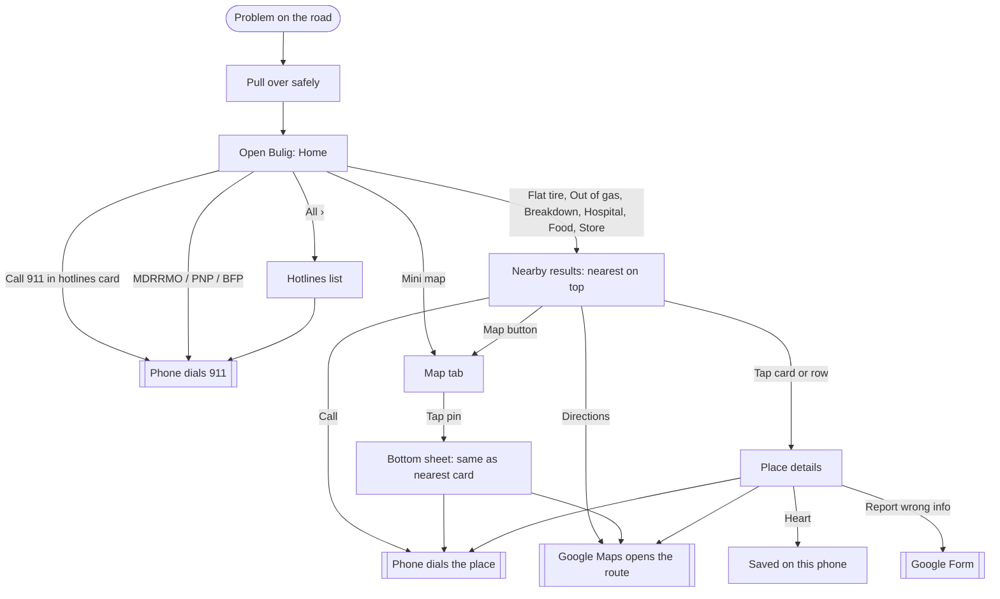

# Bulig UI and UX

How the app looks, how people move through it, and why. This is the source of truth for screens and flows. [ROADMAP.md](ROADMAP.md) says *when* each part ships, and [ARCHITECTURE.md](ARCHITECTURE.md) says *how* it's built.

Last updated: 2026-10-29 · Owner: John · Replaces the three-tab layout (Emergency, Services, About) shipped in v0.2. The new layout ships in Phase 3 (v0.3).

Visual references (private, John's account): [System Map](https://claude.ai/artifact/3CX8HnRHESS9DT4oyuycKS) (flow and wireframes) and [Nearby Results mockup](https://claude.ai/artifact/UH8x588qpo7yyHW9NM5VPr) (high-fidelity results screen).

---

## 1. The one job

Something goes wrong on the road. The person pulls over, opens Bulig, and in one or two taps is calling the nearest place that can fix that exact problem, or 911.

Every screen is judged against that sentence. If a feature doesn't make that faster or more trustworthy, it waits.

**Who it's for:** every driver and rider: motorcycles, cars, tricycles, trucks. Locals and people passing through.

**Where it's used:** on a cheap Android phone, outdoors in sunlight, often on weak or no signal, by someone stressed and in a hurry.

## 2. Problem to answer

| Problem | What Bulig shows | Data |
| --- | --- | --- |
| Flat tire | Nearest vulcanizing shops and air pumps | `tire_repair`, features `tubeless`, `air_pump`, `comes_to_you` |
| Out of gas | Nearest gas stations, then stores selling bottled fuel | `fuel`, feature `bottled_fuel` |
| Breakdown | Nearest mechanics, by vehicle type | `mechanic`, features `motorcycle`, `car_truck`, `comes_to_you` |
| Hurt or sick | Hospitals with an emergency room first, then clinics and pharmacies | `hospital`, feature `emergency_room` |
| Accident or danger | 911, then the town's MDRRMO, PNP, BFP, health unit and hospital | `EmergencyContact` |
| Hungry, need supplies | Nearest carinderias, restaurants and stores | `food`, `store` |

## 3. Navigation

Four bottom tabs, each with an icon and a label:

| Tab | Route | Purpose |
| --- | --- | --- |
| Home | `/` | Hotlines card, "What's wrong?" buttons, mini map |
| Map | `/map` | Every place as a pin around you, with filters |
| Saved | `/saved` | Places the person hearted, stored on the phone |
| Profile | `/profile` | Language, location, offline data, report wrong info, About. No sign-in |

Screens opened from a tab (no tab of their own):

| Screen | Route | Opened from |
| --- | --- | --- |
| Hotlines | `/hotlines` | Home hotlines card, "All ›" |
| Nearby results | `/nearby/:need` (`flat-tire`, `out-of-gas`, `breakdown`, `hospital`, `food`, `store`) | Home buttons |
| Place details | `/place/:id` | Any card, row, or map pin |
| About and privacy | `/about` | Profile |

**Permanent links:** `/services` and `/about` were shared in v0.2 and must keep working. `/about` stays as the About page. `/services` shows the Nearby results with every category ("All").

## 4. User flow



Bulig never sends help and never shares location. Every outcome is the person's own phone making a call or opening directions.

## 5. Screens

### Home

Must fit one 360x740 screen without scrolling.

```
┌──────────────────────────────┐
│ ◉ Near Guiuan ▾          ● │  header: town, online dot
├──────────────────────────────┤
│ Emergency hotlines     All › │  red border, light red fill
│ ┌──────────────────────────┐ │
│ │       CALL 911           │ │  one tap, tel:911
│ └──────────────────────────┘ │
│ [MDRRMO]  [ PNP ]  [ BFP  ] │  one tap each
├──────────────────────────────┤
│ What's wrong?                │
│ [Flat tire ] [Out of gas ]  │
│ [Breakdown ] [Hospital   ]  │  2x3, at least 72px tall
│ [Food      ] [Store      ]  │
│ ┌──────────────────────────┐ │
│ │  · ◉  ·   mini map       │ │  tap opens Map tab
│ │ 12 places nearby · Open ›│ │
│ └──────────────────────────┘ │
│ Pull over safely before      │
│ using your phone.            │
├──────────────────────────────┤
│ Home   Map   Saved  Profile  │
└──────────────────────────────┘
```

- **Header:** no logo. The town is the title ("Near Guiuan ▾"), from GPS when allowed, otherwise the last picked town. Tapping it opens the town picker (Guiuan, Mercedes). The brand lives on the app icon and install name.
- **Hotlines card:** 911 is always one tap, never behind a second screen. The three quick-call buttons are the picked town's MDRRMO, PNP and BFP; a missing or expired one is left out, not shown as broken. "All ›" opens Hotlines.
- **What's wrong?:** six buttons, each opening Nearby results with the matching filter preset. There's no Accident button, because the hotlines card is the accident path, and two routes to the same thing is clutter.
- **Mini map:** loads last and never delays the rest of Home. Offline, or on a phone without WebGL2, it shows a plain "Open map ›" panel instead. If the screen is too short to fit everything, drop the Store button before shrinking anything below 48px.

### Nearby results (`/nearby/:need`)

The same layout for every need, so people learn it once.

```
┌──────────────────────────────┐
│ ‹  Flat tire          [Map] │
│    Near Guiuan · 5 places    │
│ (Vulcanizing)(Air pump)(...) │  filter chips, preset by need
├──────────────────────────────┤
│ NEAREST TO YOU               │
│ ┌──────────────────────────┐ │
│ │ mini map: ◉ → pin  1.2km │ │
│ │ Sikad Vulcanizing [SAMPLE]│ │
│ │ Vulcanizing · Brgy 5      │ │
│ │ ● Usually open · until 6PM│ │
│ │ ✓Tubeless ✓Air pump ?Comes│ │
│ │ Checked May 18 · Call first│ │
│ │ [   CALL   ] [Directions] │ │
│ └──────────────────────────┘ │
│ MORE NEARBY                  │
│ ▣ Brgy 3 Air Pump   2.0km [☎]│
│ ▣ Mabini Tire Repair 3.1km[☎]│
└──────────────────────────────┘
```

- **Nearest card:** the first place after ranking. It shows a mini map strip (you and the pin), distance, name and SAMPLE badge, category and barangay, the open status, feature tags, the check date, and two 52px buttons: **Call** (filled) and **Directions** (outlined, opens Google Maps).
- **Feature tags:** "✓ Tubeless" when confirmed, a grey "? Comes to you" when not confirmed. A feature that isn't listed isn't shown at all.
- **Nearest is usually closed now:** the card border goes grey, the status reads "Usually closed now · opens 6 AM", and an amber line points to "Nearest usually open: Seaside Grill, 1.1 km ›". Nobody should drive to a locked door.
- **More nearby:** one rounded list. Each row has an icon, name, distance, a short feature note, the status, and a 48px phone button that calls without opening the place.
- **Map button:** shows the same results as pins on the Map tab.
- **Hospital:** red accent, the call button reads "Call hospital", places with an emergency room rank first, and the footer reads "Life-threatening? Call 911 from Home."

Filter presets:

| Need | Category | Chips |
| --- | --- | --- |
| `flat-tire` | `tire_repair` | Vulcanizing, Air pump, Tubeless, Usually open |
| `out-of-gas` | `fuel` | Gas station, Bottled fuel, Usually open |
| `breakdown` | `mechanic` | Motorcycle, Car/Truck, Comes to you |
| `hospital` | `hospital` | All, Emergency room, Clinic, Pharmacy |
| `food` | `food` | All, Carinderia, Restaurant, Usually open |
| `store` | `store` | All, Convenience, Hardware, Usually open |

### Hotlines (`/hotlines`)

- A red "Call 911" button at the top, then the town's numbers: MDRRMO, PNP, BFP, Rural Health Unit, hospital.
- Each row has the name, type, "Checked <date>", a SAMPLE badge when sample, and a phone icon on the right. Tapping anywhere on the row calls. No chevrons, because a chevron promises a details page.
- At the top: "Direct calls only. Bulig does not send help or share your location."
- Numbers last checked more than 180 days ago are hidden. The national number is never hidden.

### Map (`/map`)

- A full-screen map centred on the blue location dot, or on the picked town when location is off.
- Round pins with a category icon and colour. Places usually open now are full colour, and the rest are grey.
- Filter chips across the top: Vulcanizing, Air pump, Gas, Mechanic, Hospital, Food, Store, Usually open now.
- Tapping a pin opens a bottom sheet with the same content as the Nearest card. A "List" button switches to Nearby results with the same filters.
- If the map can't load (offline without cached tiles, or no WebGL2), the tab shows the list instead and says why.

### Place details (`/place/:id`)

- Name, category, barangay, distance, heart (save), SAMPLE badge.
- A green box: "Checked <date> · <how>", for example "Field visit" or "Phone call".
- Services with Yes or "Not confirmed": tube-type, tubeless, air pump, motorcycle, car/truck, comes to you (whichever apply to the category).
- Usual hours for each day, with the check date and "Hours can change. Call first."
- "Report wrong info" opens the Google Form with this place's ID filled in.
- A sticky bottom bar with Call and Directions.

### Saved (`/saved`)

- Hearted places, stored on the phone only, shown as "More nearby" rows sorted by distance.
- Empty state: "Tap the heart on any place to save it here."

### Profile (`/profile`)

There's no sign-in. The tab holds:
- Language: English, Waray.
- Location: whether it's allowed, and how to change it in phone settings.
- Offline data: "Updated <date> · 32 places on this phone".
- Report wrong info.
- About Bulig and privacy: opens `/about` ("Bulig collects nothing personal").
- App version, and a "No account needed." footer.

## 6. Rules for every screen

**Safety and trust**
- 911 is always one tap from Home. There's never a login, ad or paywall on anything to do with emergencies.
- Copy never says "request help", "help is on the way" or "location sent".
- Every place and contact shows its check date. Sample records show a grey SAMPLE badge until real data replaces them.
- "Pull over safely before using your phone" appears on Home. Bulig is designed for use when stopped, never in motion (RA 10913, the Anti-Distracted Driving Act).
- Hours are always "Usually open", never "Open now", because they're reported, not live.

**Built for a cheap phone in sunlight**
- Body text 16px or more, and nothing smaller than 13px.
- Every tap target is at least 48px. The main actions (911, Call) are the biggest things on screen.
- WCAG AA contrast (4.5:1 for text). Light theme. System fonts, with no web fonts to download.
- One green brand colour, red only for emergency and hospital, amber for food and for warnings, grey for closed or unconfirmed.

**Fast and offline**
- Home, Hotlines and Nearby results work with no signal after one visit. The map is the only part that needs a connection for new areas.
- When offline, a thin banner reads "Offline: showing saved info".
- Nothing heavy loads before 911 is on screen.

**Location**
- Don't ask for location when the app opens; most people deny a prompt with no context. Ask the first time someone taps a "What's wrong?" button or opens the Map, with one line saying why: "To show the nearest places first."
- If location is denied or slow, use the picked town and sort by name, and say "Turn on location to sort by distance."
- Distances only show when location is known.

**Ranking (Nearby results)**
1. Hospital: places with `emergency_room` first.
2. Then by straight-line distance from the person (places without coordinates go last).
3. Without location: by name, within the picked town.
4. Nearest-usually-open is worked out separately, for the "Nearest usually open" line.

## 7. States to design

| State | What shows |
| --- | --- |
| First open, no location yet | The picked town (default: first pilot town). The prompt appears only on first use of a button or the Map. |
| Location denied | The town picker stays the source of truth, sorted by name, with a one-line hint. |
| Offline | The banner. Cached data everywhere, and the mini map swaps to the plain panel. |
| No results for a filter | "No places with <filter> near <town> yet." plus a "Clear filters" button and "Know one? Tell us" (opens the Form). |
| Nearest is usually closed | A grey card plus the amber "Nearest usually open" line. |
| Data older than 30 days on the phone | Profile's offline row turns amber: "Updated 34 days ago, connect to refresh." |
| Expired emergency number | Hidden. The national number is never hidden. |

## 8. Not in the UI yet, and when

| Feature | When | Why not now |
| --- | --- | --- |
| Ratings and reviews | Phase 5, if John decides so | Needs accounts, a backend and enough users to mean anything. The check date is the trust signal until then. |
| Alert when near a saved place | Phase 6 (Android app) | Browsers can't track location in the background. |
| Places along my route | Phase 7 | Needs a routing engine and a connection. |
| Sign-in, owner portal, admin screens | Phases 4 and 5 | The admin panel is Filament, which brings its own UI. |
| Live "Open now" | Only if owners update their status | Reported hours can only say "usually". |
| Dispatching help, live tracking | Never | It would be a false safety promise. |

## 9. Data the UI needs

All additive and optional, so contract v1 stays (see [ARCHITECTURE.md](ARCHITECTURE.md#1-data-contract)):

- `Area.lat`, `Area.lng`: the town centre, used to detect the town from GPS (nearest centre) and to centre the map when location is off.
- `Service.features`: confirmed features as `Partial<Record<Feature, boolean>>`. `true` means confirmed, `false` means confirmed not offered, and a missing key means not confirmed.
- `Service.weeklyHours`: per-day open and close times, for example `{ "mon": [["07:00", "18:00"]] }`. `Service.open24h` is for hospitals. The old free-text `hours` stays for display until every record is converted.
- `Service.subtype` (optional): for chips like Carinderia vs Restaurant, Clinic vs Pharmacy.

Features: `tubeless`, `tube_type`, `air_pump`, `comes_to_you`, `motorcycle`, `car_truck`, `bottled_fuel`, `emergency_room`.
