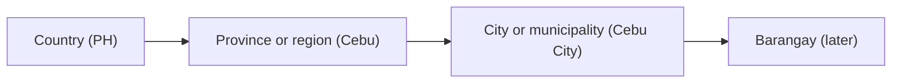
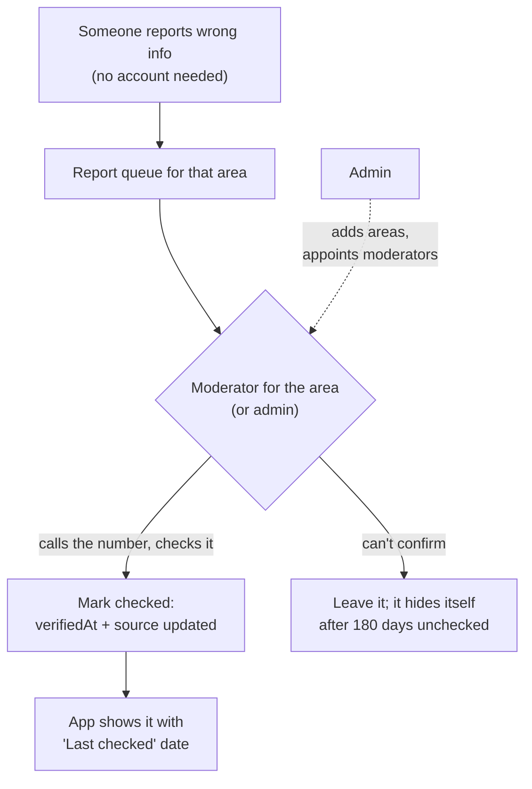
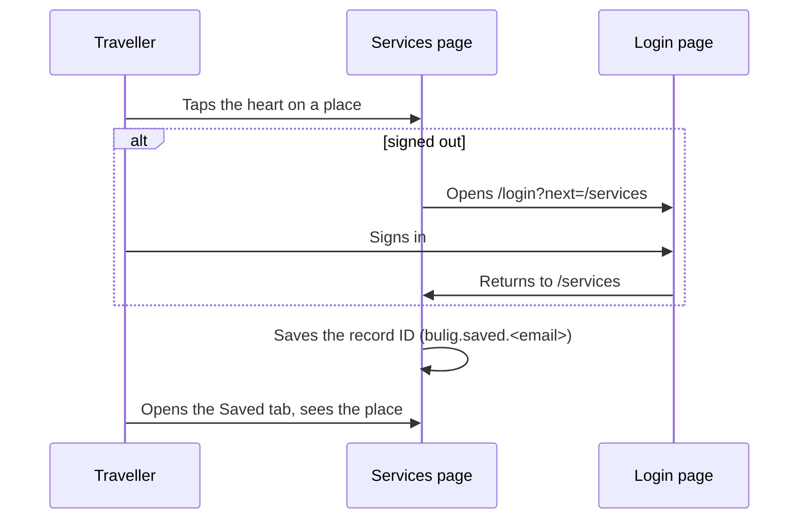
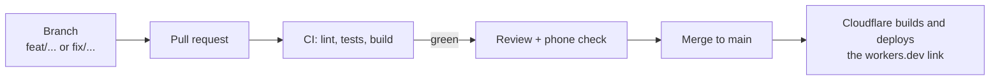

# Bulig System Workflow

Who does what in Bulig, how a record moves from a report to the app, and how a change moves from a branch to the live link. [ARCHITECTURE.md](ARCHITECTURE.md) says how each part is built; this file says how the parts are used.

Last updated: 2026-10-29

## Areas

Bulig covers the whole Philippines first, then any country. Every record belongs to one country and one area.

- An area has a `level` in the country's own words (`city`, `municipality`, later `barangay`) and an optional `parent` (the area it sits inside). Province or region is the `region` text on each area.
- Today every area is a city or municipality at the top level. Barangays come later as new rows with `parent` set to their city or municipality. That's a data change, not a code change.
- Other countries use their own levels (a county, a district). Nothing in code names a level.

## Roles

Three roles. What each may do is decided in one function, `can()` in [`app/src/rules/permissions.ts`](../app/src/rules/permissions.ts), and tested in `permissions.test.ts`.

| Role | Who | May do | Scope |
| --- | --- | --- | --- |
| **User** | Anyone who signs in | Save places and numbers; report wrong info | Everywhere |
| **Moderator** | A trusted local person, one or more per area (a barangay, city or municipality) | Everything a user can, plus review reports and mark records checked | Only their areas, and the areas inside them |
| **Admin** | The Bulig team | Everything: manage areas, moderators and every record | Everywhere |

- **No account at all** still gets everything a traveller needs: Emergency Help, Services, Call and Directions. Emergency Help never asks for an account, in any phase.
- A moderator of a city also covers every barangay inside it (`isWithin()` walks up the `parent` chain).
- A moderator acts on one area at a time. With no area given, `can()` says no.

## Sign-in

| Phase | How it works |
| --- | --- |
| **Now (test UI)** | On `/login` and `/signup` (the onboarding). Everything except Emergency needs an account; "Continue without an account" gives Emergency only. Three hardcoded test logins, all with the password `password`, in [`app/src/auth/testAccount.ts`](../app/src/auth/testAccount.ts): `test@bulig.com` (**user**), `moderator@bulig.com` (**moderator** for Cebu City), `admin@bulig.com` (**admin**). **Create account** makes a **user** kept on this phone only ([`localAccounts.ts`](../app/src/auth/localAccounts.ts)): name, email and a salted SHA-256 hash of the password in `bulig.accounts`, never the password itself. Moderators and admins are never self-registered. The session and saved places are kept in `localStorage` on the phone. |
| **Phase 4** | Laravel Sanctum accounts; requests and payloads in [API.md](API.md#4-accounts). Admins and moderators sign in to Filament; the API checks roles with the same rules as `can()`. |
| **Phase 5** | Travellers and business owners sign in (Google through Socialite, Sanctum tokens). Saved places sync to the account. |

**The test logins and local accounts are not security.** The test logins ship inside the app's JavaScript, so anyone can read them; they exist only so testers can try each role. Local accounts live in the phone's storage, readable by anyone holding the phone; hashing only keeps a reused password out of plain text. Never put a real password in the app, and remove `testAccount.ts` and `localAccounts.ts` when Phase 4 sign-in lands. `AuthProvider` is the only place to change: pages call `useAuth()` and don't know where the account comes from.

Saving flow:

## Records

1. **Collect:** a record needs a name, an area, a phone or landmark, a source and the date it was checked. Sample records carry `"sample": true` and show a SAMPLE badge.
2. **Check:** someone calls the number or visits. Only then does `verifiedAt` change.
3. **Publish:** Phases 1 to 3, edit `app/public/data/<cc>/*.json` by pull request (CI validates every file). Phase 4 on, a moderator or admin marks it checked in Filament.
4. **Expire:** local emergency numbers not checked in 180 days are hidden on the phone (`visibleContacts()`). The national number never hides.
5. **Report:** "Report wrong info" (Phase 3) feeds the queue above.

## Changing the app

- `main` is always deployable. Work on a branch, open a PR, wait for green CI, merge.
- Every change goes into `docs/CHANGELOG.md` under **Unreleased**.
- UI changes follow [UI-UX.md](UI-UX.md) (section 10 for the look) and get a screenshot check at phone and desktop widths, light and dark.
